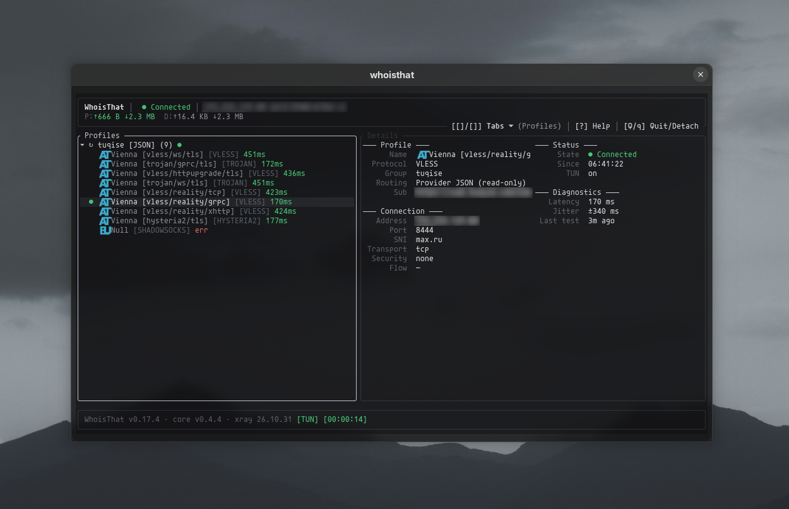
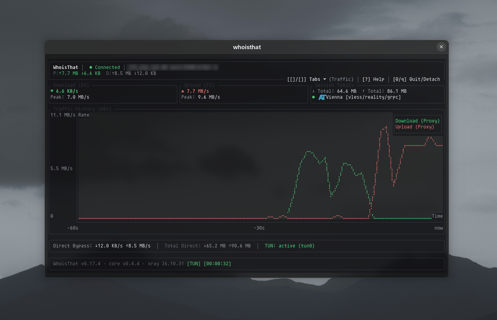

<div align="center">
  
  <h1>WhoisThat</h1>
  <p><strong>A terminal-based VPN/proxy client for Linux.</strong></p>
  <p>Rust TUI and CLI, a Go core, and a pinned Xray runtime.</p>

  <p>
    <a href="https://docs.tuqise.com/"></a>
    <a href="https://launchpad.net/~kvunoff/+archive/ubuntu/whoisthat"></a>
    <a href="https://aur.archlinux.org/packages/whoisthat-bin"></a>
    <a href="https://aur.archlinux.org/packages/whoisthat"></a>
    <a href="https://github.com/kvunoff/whoisthat-extension"></a>
    <a href="LICENSE"></a>
  </p>

  <p>
    <a href="#installation">Installation</a> •
    <a href="#features">Features</a> •
    <a href="#quick-start">Quick Start</a> •
    <a href="https://docs.tuqise.com/"><strong>Documentation ↗</strong></a>
  </p>
</div>

---

## Overview

WhoisThat runs a local SOCKS5/HTTP proxy or a system-wide TUN interface from a terminal. Profiles, subscriptions, routing, DNS, the kill-switch and the encrypted database belong to the Go core; the Rust client renders state and sends commands over IPC.

- Proxy mode needs only the binaries and a reachable server.
- TUN mode needs Linux with `/dev/net/tun`, nftables or iptables, and a one-time `authorize-core` step.
- One core runs per host; TUN, kill-switch and DNS are system-wide.

<div align="center">
  
  <br/><br/>
  
</div>

---

## Features

- **Proxy and TUN modes.** Switch between a local SOCKS5/HTTP proxy and system-wide routing through `whoisthattun`.
- **Rootless TUN.** File capabilities gated by a root-owned per-uid allowlist; no setuid binary.
- **Split tunneling.** Route selected applications inside or outside the tunnel with cgroup v2, using systemd slices or the per-user runner.
- **Xray protocols.** VLESS (Reality, Vision, xHTTP, gRPC, WebSocket), VMess, Trojan, Shadowsocks 2022, SOCKS5 and Hysteria2.
- **Anti-DPI.** Editable TLS-hello fragmentation and UDP noise on top of Xray `finalmask`, with provider mask passthrough.
- **Subscriptions and routing.** Happ routing profiles, JSON subscriptions, provider auto-update and a single first-match routing engine.
- **DNS and leak protection.** DNS hijack, FakeDNS, an independent kill-switch and IPv6 leak prevention.
- **Encrypted state.** Profiles, subscriptions and custom rules are stored locally with AES-256-GCM.
- **Terminal workflow.** Braille traffic charts, `wit://` imports and NDJSON status for Waybar/Polybar.

---

## Installation

Pick **one** method. The installer, distribution packages, PPA and AUR packages own the same files and conflict with each other.

### Install script

```bash
curl -fsSL https://raw.githubusercontent.com/kvunoff/whoisthat/main/install.sh | bash
```

The script verifies SHA-256 checksums and authorizes the invoking user. Every release archive also carries a GitHub build-provenance attestation:

```bash
gh attestation verify <archive> --repo kvunoff/whoisthat
```

### Packages and AUR

| Method | Command |
| :--- | :--- |
| Debian / Ubuntu | `sudo apt install ./whoisthat_<version>-1_amd64.deb` |
| Fedora / RHEL | `sudo dnf install ./whoisthat-<version>-1.x86_64.rpm` |
| Ubuntu PPA | `sudo add-apt-repository ppa:kvunoff/whoisthat`<br>`sudo apt update && sudo apt install whoisthat` |
| Arch Linux | `paru -S whoisthat-bin` (prebuilt) or `paru -S whoisthat` (source) |

The `.deb` and `.rpm` packages apply the file capabilities and create the allowlist directory and host-wide lock, but do not authorize a user. Run once:

```bash
sudo /usr/lib/whoisthat/authorize-core --add $USER
```

The TUI also offers a `pkexec` prompt when it starts a capped core. The AUR packages authorize the invoking user when `SUDO_USER` is available. A capless build used for proxy mode or development needs no entry.

<details>
<summary>Build from source</summary>

Rust 1.88+ and Go 1.26.11+.

```bash
# Build the Go core
cd core/core && go build -o whoisthat-core && cd ../..

# Build the Rust client
cargo build --release --locked

# Install and authorize
sudo install -Dm755 target/release/whoisthat /usr/bin/whoisthat
sudo install -Dm755 target/release/whoisthat-runner /usr/bin/whoisthat-runner
sudo install -Dm755 core/core/whoisthat-core /usr/bin/whoisthat-core
sudo install -Dm755 scripts/authorize-core /usr/lib/whoisthat/authorize-core
sudo /usr/lib/whoisthat/authorize-core --add "$USER"
```

See [Build & Run](https://docs.tuqise.com/developers/build) for the full development loop.

</details>

---

## Quick start

```bash
whoisthat
```

| Key | Action |
| :---: | :--- |
| <kbd>j</kbd> / <kbd>k</kbd> | Move selection |
| <kbd>Tab</kbd> | Switch focus between Tree and Details |
| <kbd>1</kbd> – <kbd>5</kbd> | Jump to Profiles, Routing, Traffic, Logs or Settings |
| <kbd>c</kbd> / <kbd>Enter</kbd> | Connect to the selected profile |
| <kbd>d</kbd> | Disconnect |
| <kbd>v</kbd> | Toggle TUN mode / proxy mode |
| <kbd>t</kbd> / <kbd>T</kbd> | Test the focused profile / all profiles |
| <kbd>q</kbd> / <kbd>Q</kbd> | Detach / quit completely |

Press <kbd>?</kbd> for help. The full keymap is in [Navigation](https://docs.tuqise.com/usage/navigation).

### CLI

```bash
whoisthat -t                  # toggle connection
whoisthat status -s           # compact status
whoisthat run -d spotify      # launch an app in the split-tunnel cgroup
whoisthat profile list        # profiles with latency and loss
whoisthat sub refresh --all   # refresh every subscription
whoisthat core status         # core health, capabilities, authorization
whoisthat doctor              # system diagnostics
```

The full command tree is in the [CLI reference](https://docs.tuqise.com/reference/cli).

---

## Documentation

Full documentation is at **[docs.tuqise.com](https://docs.tuqise.com/)**:

- [Quick Start](https://docs.tuqise.com/guide/quick-start)
- [CLI Reference](https://docs.tuqise.com/reference/cli)
- [System Architecture](https://docs.tuqise.com/architecture/overview)
- [Troubleshooting & Doctor](https://docs.tuqise.com/reference/troubleshooting)

---

## Ecosystem

- **[GNOME Shell Extension](https://github.com/kvunoff/whoisthat-extension)** — top-bar status, real-time speed and quick controls.
- **[Deep Links (`wit://`)](https://docs.tuqise.com/integrations/deeplinks)** — one-click profile and subscription imports from a browser.
- **[whoisthat-core](https://github.com/kvunoff/whoisthat-core)** — standalone mirror of the Go core (`core/core`), rebuilt on every core change and `core-v*` tag.

---

## Support the Project

WhoisThat is built and maintained in spare time. If it saves you from a
bulky desktop client, donations are appreciated.

| Network | Address |
| :--- | :--- |
| **Bitcoin (BTC)** | `bc1qutg32qasdyuuc03l9rtm3uxwncfjafqnhpnnec` |
| **Ethereum (ETH / ERC-20)** | `0x7C643C5b704ADD1888a0F68457cf6b0c5c3508C6` |
| **Tron (TRX / TRC-20)** | `TWSvpXfJsYcDVB9PEwVAgCUXT5RSdtxaYL` |
| **TON (GRAM / jettons)** | `UQAablx88aAbnjXTnU2t6LYoEHIEQeCv6wMqYZaqeoNjSb_x` |
| **Solana (SOL / SPL)** | `DckqFaa2PUikF3eQCt79vzGrg1xCM1j3uYyUNDSsswoX` |

Each address accepts the network's native coin and, where the network supports
them, stablecoins (USDT/USDC): ERC-20 on Ethereum, TRC-20 on Tron, SPL on
Solana, jettons on TON. The Bitcoin address accepts BTC only.

The native coin of TON is **Gram (GRAM)** — formerly Toncoin (TON). The
blockchain is still called TON, and the address is unchanged.

---

## Credits & License

- Built on top of the exceptional [Xray-core](https://github.com/XTLS/Xray-core).
- Licensed under the [MIT License](LICENSE).
