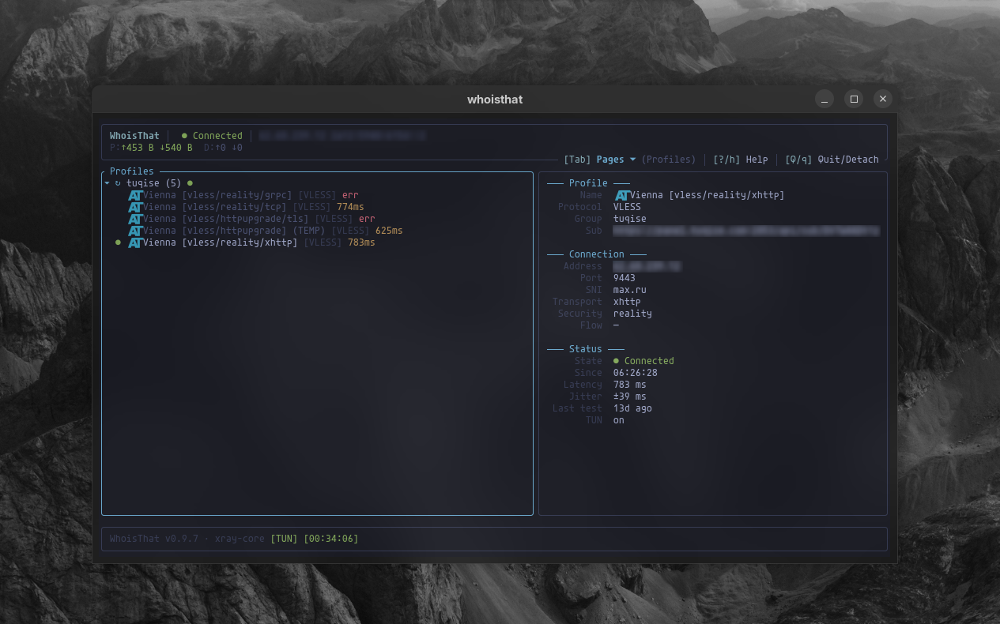
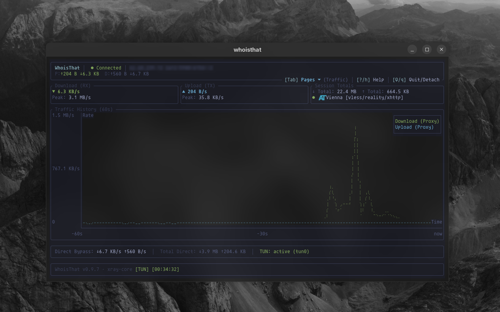

<div align="center">
  
  <h1>WhoisThat</h1>
  <p><strong>Modern terminal-based VPN client for Linux.</strong></p>
  <p>High-performance Rust TUI frontend paired with an autonomous Go engine backed by Xray-core.</p>

  <p>
    <a href="https://docs.tuqise.com/"></a>
    <a href="https://aur.archlinux.org/packages/whoisthat"></a>
    <a href="https://extensions.gnome.org/extension/10998/whoisthat-vpn-indicator/"></a>
    <a href="LICENSE"></a>
  </p>

  <p>
    <a href="#quick-installation">Installation</a> •
    <a href="#key-features">Features</a> •
    <a href="#quick-start">Quick Start</a> •
    <a href="https://docs.tuqise.com/"><strong>Full Documentation ↗</strong></a>
  </p>
</div>

---

## Overview

**WhoisThat** brings ergonomic terminal interaction to modern proxy circumvention and system-wide VPN networking. It eliminates the need for bulky Electron apps while delivering full rootless TUN routing, application-level split tunneling via cgroup v2, real-time Braille bandwidth graphs, and comprehensive provider subscription management.

<div align="center">
  
  <br/><br/>
  
</div>

---

## Key Features

- **Unified Multi-Protocol Engine**: Native support for VLESS (Reality, Vision, xHTTP, gRPC, WebSocket), VMess, Trojan, Shadowsocks (2022 specs), SOCKS5, and Hysteria2 via pinned Xray-core (`v26.9.9`).
- **Rootless System-Wide TUN**: Full OS-level VPN routing via Linux file capabilities (`cap_net_admin,cap_net_raw,cap_setpcap`) without root privileges or setuid binaries.
- **cgroup v2 Split Tunneling**: Selectively bypass or enforce VPN routing per application (`whoisthat run <app>`) using transient systemd slices and policy routing.
- **Fail-Safe Kill-Switch**: Independent nftables firewall protection blocks non-VPN traffic if the connection drops unexpectedly.
- **Happ Routing & Presets**: Ingests provider Happ routing profiles (`happ://routing/...`) with per-group modes (`auto`, `manual`, `subscription`) and 1-click preset rules (ad blocking, domestic bypass, media, AI).
- **Encrypted State at Rest**: Credentials, subscriptions, and custom rules are encrypted locally with AES-256-GCM.
- **Real-Time Traffic Monitoring**: Unicode Braille bandwidth monitor (RX/TX), dynamic scaling, and interface health metrics.
- **Desktop & Ecosystem Integration**: 1-click browser imports (`wit://`), official GNOME Shell extension, and continuous NDJSON streaming for Waybar and Polybar.

---

## Quick Installation

### One-Line Install Script (Any Linux Distro)
```bash
curl -fsSL https://raw.githubusercontent.com/kvunoff/whoisthat/main/install.sh | bash
```

### Arch Linux (AUR)
```bash
paru -S whoisthat
# or
yay -S whoisthat
```

### Build from Source
```bash
# Build Go daemon
cd core/core && go build -o whoisthat-core && cd ../..

# Build Rust TUI
cargo build --release

# Install & set capabilities
sudo install -Dm755 target/release/whoisthat /usr/local/bin/whoisthat
sudo install -Dm755 core/core/whoisthat-core  /usr/local/bin/whoisthat-core
sudo setcap cap_net_admin,cap_net_raw,cap_setpcap=+ep /usr/local/bin/whoisthat-core
```

---

## Quick Start

Launch the interactive interface:
```bash
whoisthat
```

### Essential Keybindings

| Key | Action |
| :---: | :--- |
| <kbd>j</kbd> / <kbd>k</kbd> | Move cursor down / up |
| <kbd>h</kbd> / <kbd>l</kbd> | Collapse / expand group (or jump to Details) |
| <kbd>Tab</kbd> | Switch focus between Tree and Details panels |
| <kbd>[</kbd> / <kbd>]</kbd> | Cycle tabs left / right |
| <kbd>1</kbd> – <kbd>5</kbd> | Jump to tab (Profiles, Routing, Traffic, Logs, Settings) |
| <kbd>c</kbd> / <kbd>Enter</kbd> | Connect to selected profile |
| <kbd>d</kbd> | Disconnect active connection |
| <kbd>v</kbd> | Toggle between TUN mode (system-wide) and Proxy mode |
| <kbd>t</kbd> / <kbd>T</kbd> | Test focused profile / test all profiles |
| <kbd>u</kbd> / <kbd>r</kbd> | Refresh active subscription |
| <kbd>A</kbd> / <kbd>n</kbd> | Add new subscription group |
| <kbd>a</kbd> | Import single proxy URI (`vless://`, `hy2://`, etc.) |
| <kbd>?</kbd> | Open interactive help dialog |
| <kbd>q</kbd> | **Detach TUI** (VPN stays connected in background) |
| <kbd>Q</kbd> | **Quit completely** (shuts down VPN and exits) |

### Headless CLI Quick Toggles

```bash
whoisthat -t             # Smart toggle connection (reconnects to last profile or disconnects)
whoisthat -mt            # Toggle between TUN mode and Proxy mode
whoisthat -kt            # Toggle Kill-Switch protection
whoisthat status -s      # Compact status (e.g. [Connected] [TUN] ↓ 2.4 MB/s ↑ 410.0 KB/s)
whoisthat run -d spotify # Launch Spotify bypassing the VPN tunnel
whoisthat doctor         # Run system capability and runtime diagnostic suite
```

---

## Complete Documentation

Full, comprehensive documentation with technical deep-dives, configuration guides, and architectural diagrams is available at:

👉 **[https://docs.tuqise.com/](https://docs.tuqise.com/)**

* 📖 **[Getting Started](https://docs.tuqise.com/guide/quick-start)** — Installation, setup, and first steps.
* 🏛️ **[System Architecture](https://docs.tuqise.com/architecture/overview)** — Go daemon, IPC transport, and security model.
* 🌐 **[Networking & TUN](https://docs.tuqise.com/networking/tun-mode)** — Rootless capabilities, DNS hijack, and Conntrack reply routing.
* 🔀 **[Split Tunneling Guide](https://docs.tuqise.com/networking/split-tunnel)** — cgroup v2 transient slices, single-instance apps, and desktop integration.
* 🔌 **[Desktop & Widgets](https://docs.tuqise.com/integrations/desktop-widgets)** — Waybar, Polybar, and GNOME Shell extension.
* 📜 **[Wire Protocol & API](https://docs.tuqise.com/reference/protocol)** — Length-prefixed IPC specification and Python client example.
* 🩺 **[Troubleshooting & Doctor](https://docs.tuqise.com/reference/troubleshooting)** — Health diagnostics matrix and common fixes.

---

## Ecosystem & Extensions

- **[GNOME Shell Extension](https://extensions.gnome.org/extension/10998/whoisthat-vpn-indicator/)** — Top-bar status badge, real-time speed monitor, and quick controls.
- **[Deep Links (`wit://`)](https://docs.tuqise.com/integrations/deeplinks)** — One-click profile and subscription imports directly from web browsers.

---

## Credits & License

- Built on top of the exceptional [Xray-core](https://github.com/XTLS/Xray-core).
- Licensed under the [MIT License](LICENSE).
