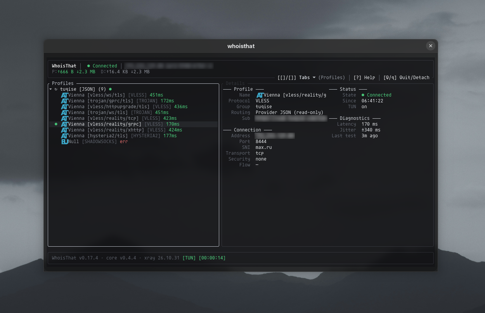
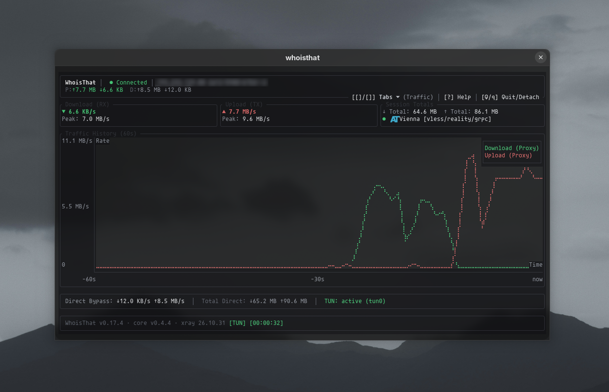

<div align="center">
  
  <h1>WhoisThat</h1>
  <p><strong>Modern terminal-based VPN client for Linux.</strong></p>
  <p>High-performance Rust TUI frontend paired with an autonomous Go engine backed by Xray-core.</p>

  <p>
    <a href="https://docs.tuqise.com/"></a>
    <a href="https://launchpad.net/~kvunoff/+archive/ubuntu/whoisthat"></a>
    <a href="https://aur.archlinux.org/packages/whoisthat-bin"></a>
    <a href="https://aur.archlinux.org/packages/whoisthat"></a>
    <a href="https://github.com/kvunoff/whoisthat-extension"></a>
    <a href="LICENSE"></a>
  </p>

  <p>
    <a href="#quick-installation">Installation</a> •
    <a href="#key-features">Features</a> •
    <a href="#quick-start">Quick Start</a> •
    <a href="https://docs.tuqise.com/"><strong>Full Documentation ↗</strong></a>
  </p>
</div>

---

## Overview

**WhoisThat** brings ergonomic terminal interaction to modern proxy circumvention and system-wide VPN networking. It eliminates the need for bulky Electron apps while delivering full rootless TUN routing, application-level split tunneling via cgroup v2, real-time Braille bandwidth graphs, and comprehensive provider subscription management.

<div align="center">
  
  <br/><br/>
  
</div>

---

## Key Features

- **Unified Multi-Protocol Engine**: Native support for VLESS (Reality, Vision, xHTTP, gRPC, WebSocket), VMess, Trojan, Shadowsocks (2022 specs), SOCKS5, and Hysteria2 via pinned Xray-core (`v26.10.31`).
- **Rootless System-Wide TUN**: Full OS-level VPN routing via Linux file capabilities (`cap_net_admin,cap_net_raw,cap_setpcap`) without root privileges or setuid binaries.
- **cgroup v2 Split Tunneling**: Selectively bypass or enforce VPN routing per application (`whoisthat run <app>`) using transient systemd slices and policy routing.
- **Fail-Safe Kill-Switch**: Independent nftables firewall protection blocks non-VPN traffic if the connection drops unexpectedly.
- **Happ Routing & Presets**: Ingests provider Happ routing profiles (`happ://routing/...`) with per-group modes (`auto`, `manual`, `subscription`) and 1-click preset rules (ad blocking, domestic bypass, media, AI).
- **JSON Subscriptions**: Imports per-server Xray configurations (`<subscription>/json`) with provider-owned routing and balancers. Provider rules stay immutable while manual rules keep priority.
- **Provider-Driven Auto-Update**: Honours `profile-update-interval` (header or body, hours), catches up missed refreshes after a long shutdown, and can be disabled or overridden per subscription. Background refreshes never disturb a live VPN session.
- **DNS Hijack & FakeDNS**: Captures system DNS through a reserved TUN sink, routes queries through tagged domestic/remote resolvers, and allocates FakeDNS addresses only in safe TUN + global-proxy modes. Split-excluded apps keep resolving directly.
- **Encrypted State at Rest**: Credentials, subscriptions, and custom rules are encrypted locally with AES-256-GCM.
- **Real-Time Traffic Monitoring**: Unicode Braille bandwidth monitor (RX/TX), dynamic scaling, and interface health metrics.
- **Desktop & Ecosystem Integration**: 1-click browser imports (`wit://`), official GNOME Shell extension, and continuous NDJSON streaming for Waybar and Polybar.

---

## Quick Installation

### One-Line Install Script (Any Linux Distro)
```bash
curl -fsSL https://raw.githubusercontent.com/kvunoff/whoisthat/main/install.sh | bash
```
Downloads the prebuilt static musl binaries from the latest release and verifies
their SHA-256 checksums. Every archive also carries a GitHub build-provenance
attestation: `gh attestation verify <file> --repo kvunoff/whoisthat`. Use
`--release vX.Y.Z` to pin a version or `--from-source` to build locally.

Pick **one** installation method: the script, a distribution package, the
Ubuntu PPA and an AUR package install the same files and conflict with each
other.

### Distribution Packages
Every release ships `.deb` and `.rpm` packages for `amd64` and `arm64`:

```bash
sudo apt install ./whoisthat_<version>-1_amd64.deb
sudo dnf install ./whoisthat-<version>-1.x86_64.rpm
```

Ubuntu 24.04 LTS (Noble) users can install from the PPA instead:

```bash
sudo add-apt-repository ppa:kvunoff/whoisthat
sudo apt update
sudo apt install whoisthat
```

The PPA package sets the required file capabilities in its post-install script,
so no manual `setcap` step is needed. It currently publishes Noble `amd64`
builds; enable additional series or architectures in the PPA settings, or use
the release `.deb` or the installer.

### Arch Linux (AUR)
```bash
paru -S whoisthat-bin   # prebuilt binaries
# or
paru -S whoisthat       # build from source
```

The two AUR packages conflict; pacman will prompt to remove the other when you
switch.

### Build from Source
```bash
# Build Go daemon
cd core/core && go build -o whoisthat-core && cd ../..

# Build Rust TUI
cargo build --release --locked

# Install & set capabilities
sudo install -Dm755 target/release/whoisthat /usr/bin/whoisthat
sudo install -Dm755 core/core/whoisthat-core  /usr/bin/whoisthat-core
sudo setcap cap_net_admin,cap_net_raw,cap_setpcap=+ep /usr/bin/whoisthat-core
```

---

## Quick Start

Launch the interactive interface:
```bash
whoisthat
```

### Essential Keybindings

| Key | Action |
| :---: | :--- |
| <kbd>j</kbd> / <kbd>k</kbd> | Move cursor down / up |
| <kbd>h</kbd> / <kbd>l</kbd> | Collapse / expand group (or jump to Details) |
| <kbd>Tab</kbd> | Switch focus between Tree and Details panels |
| <kbd>[</kbd> / <kbd>]</kbd> | Cycle tabs left / right |
| <kbd>1</kbd> – <kbd>5</kbd> | Jump to tab (Profiles, Routing, Traffic, Logs, Settings) |
| <kbd>c</kbd> / <kbd>Enter</kbd> | Connect to selected profile |
| <kbd>d</kbd> | Disconnect active connection |
| <kbd>v</kbd> | Toggle between TUN mode (system-wide) and Proxy mode |
| <kbd>t</kbd> / <kbd>T</kbd> | Test focused profile / test all profiles |
| <kbd>u</kbd> / <kbd>r</kbd> | Refresh active subscription |
| <kbd>A</kbd> / <kbd>n</kbd> | Add new subscription group |
| <kbd>a</kbd> | Import single proxy URI (`vless://`, `hy2://`, etc.) |
| <kbd>?</kbd> | Open interactive help dialog |
| <kbd>q</kbd> | **Detach TUI** (VPN stays connected in background) |
| <kbd>Q</kbd> | **Quit completely** (shuts down VPN and exits) |

### Headless CLI Quick Toggles

```bash
whoisthat -t             # Smart toggle connection (reconnects to last profile or disconnects)
whoisthat -mt            # Toggle between TUN mode and Proxy mode
whoisthat -kt            # Toggle Kill-Switch protection
whoisthat status -s      # Compact status (e.g. [Connected] [TUN] ↓ 2.4 MB/s ↑ 410.0 KB/s)
whoisthat run -d spotify # Launch Spotify bypassing the VPN tunnel
whoisthat run %command%  # Steam Launch Options: bypass VPN for lowest native ping
whoisthat doctor         # Run system capability and runtime diagnostic suite
```

Everything else is available without the TUI:

```bash
whoisthat profile list           # profiles with latency, loss and active marker
whoisthat sub list               # subscription groups and traffic counters
whoisthat sub refresh --all      # refresh every subscription
whoisthat mode status            # current TUN/proxy mode
whoisthat settings set split-tunnel=exclude kill-switch=true
whoisthat logs --follow          # tail the core log
whoisthat core status            # daemon version, socket, capabilities
whoisthat route list --group Work
whoisthat test group Work --wait
```

See the [CLI reference](https://docs.tuqise.com/reference/cli) for the full command tree.

---

## Complete Documentation

Full, comprehensive documentation with technical deep-dives, configuration guides, and architectural diagrams is available at:

👉 **[https://docs.tuqise.com/](https://docs.tuqise.com/)**

* 📖 **[Getting Started](https://docs.tuqise.com/guide/quick-start)** — Installation, setup, and first steps.
* 🏛️ **[System Architecture](https://docs.tuqise.com/architecture/overview)** — Go daemon, IPC transport, and security model.
* 🌐 **[Networking & TUN](https://docs.tuqise.com/networking/tun-mode)** — Rootless capabilities, DNS hijack, and Conntrack reply routing.
* 🔀 **[Split Tunneling Guide](https://docs.tuqise.com/networking/split-tunnel)** — cgroup v2 transient slices, single-instance apps, and desktop integration.
* 🔌 **[Desktop & Widgets](https://docs.tuqise.com/integrations/desktop-widgets)** — Waybar, Polybar, and GNOME Shell extension.
* 📜 **[Wire Protocol & API](https://docs.tuqise.com/reference/protocol)** — Length-prefixed IPC specification and Python client example.
* 🩺 **[Troubleshooting & Doctor](https://docs.tuqise.com/reference/troubleshooting)** — Health diagnostics matrix and common fixes.

---

## Ecosystem & Extensions

- **[GNOME Shell Extension](https://github.com/kvunoff/whoisthat-extension)** — Top-bar status badge, real-time speed monitor, and quick controls.
- **[Deep Links (`wit://`)](https://docs.tuqise.com/integrations/deeplinks)** — One-click profile and subscription imports directly from web browsers.
- **[whoisthat-core](https://github.com/kvunoff/whoisthat-core)** — Standalone mirror of the Go daemon (`core/core`), rebuilt on every core change and `core-v*` tag.

---

## Support the Project

WhoisThat is built and maintained in spare time. If it saves you from a
bulky desktop client, donations are appreciated.

| Network | Address |
| :--- | :--- |
| **Bitcoin (BTC)** | `bc1qutg32qasdyuuc03l9rtm3uxwncfjafqnhpnnec` |
| **Ethereum (ETH / ERC-20)** | `0x7C643C5b704ADD1888a0F68457cf6b0c5c3508C6` |
| **Tron (TRX / TRC-20)** | `TWSvpXfJsYcDVB9PEwVAgCUXT5RSdtxaYL` |
| **TON (GRAM / jettons)** | `UQAablx88aAbnjXTnU2t6LYoEHIEQeCv6wMqYZaqeoNjSb_x` |
| **Solana (SOL / SPL)** | `DckqFaa2PUikF3eQCt79vzGrg1xCM1j3uYyUNDSsswoX` |

Each address accepts the network's native coin and, where the network supports
them, stablecoins (USDT/USDC): ERC-20 on Ethereum, TRC-20 on Tron, SPL on
Solana, jettons on TON. The Bitcoin address accepts BTC only.

The native coin of TON is **Gram (GRAM)** — formerly Toncoin (TON). The
blockchain is still called TON, and the address is unchanged.

---

## Credits & License

- Built on top of the exceptional [Xray-core](https://github.com/XTLS/Xray-core).
- Licensed under the [MIT License](LICENSE).
