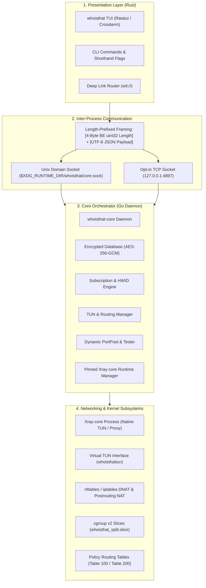

# System Architecture Overview

WhoisThat is engineered as a distributed, decoupled system where user interface logic is strictly isolated from core network daemon operations.

---

## Architectural Breakdown

The system comprises four distinct layers:

---

## Why This Multi-Language Hybrid?

| Role | Technology | Rationale |
| :--- | :--- | :--- |
| **Frontend TUI & CLI** | **Rust** (`ratatui`, `tokio`, `crossterm`) | Zero garbage collection pauses, instant sub-millisecond startup for CLI tools, type-safe responsive UI layout calculation, robust async event loops. |
| **Core VPN Daemon** | **Go** (`whoisthat-core`) | Concurrent network socket handling, clean cross-platform network API bindings, simple subprocess management, and direct compatibility with Go-based proxy ecosystems. |
| **Proxy Engine** | **Xray-core** (pinned v26.10.29) | Battle-tested, high-throughput implementation of VLESS Reality, Vision flow, gRPC/xHTTP transports, and unified Hysteria2 QUIC support. |

---

## Life of a Packet

### 1. In Proxy Mode (SOCKS5/HTTP)
1. Local applications configure their proxy settings to point at `127.0.0.1:3090` (SOCKS5) or `3091` (HTTP).
2. Xray-core receives proxy requests on the designated local inbound port.
3. User routing rules evaluate the destination host and IP:
   * **Direct**: Xray routes the packet out through its `freedom` outbound via your physical gateway.
   * **Proxy**: Xray encrypts and encapsulates the connection inside the active protocol (e.g. VLESS Reality) and forwards it to the remote VPN server.
   * **Block**: The connection is immediately dropped via the `blackhole` outbound.

### 2. In System-Wide TUN Mode
1. The kernel intercepts all outbound traffic using policy routing directed to the `whoisthattun` virtual adapter.
2. Xray's native TUN inbound reads raw IP packets from the TUN file descriptor.
3. DNS is captured before it can leave the physical interface:
   * With Happ DNS, `nat OUTPUT` DNATs port 53 to the reserved sink `198.18.0.53` / `fd00::53`, which is not assigned to any interface and therefore follows the TUN default route.
   * Early returns keep the hijack away from `fwmark 1` sockets (Xray's direct outbound and split-exclude apps), the sink itself, and the VPN server addresses.
   * `resolvectl` points systemd-resolved at the same sink.
   * Xray receives the query on `tun-in` and routes it to `dns-out`; the tagged `domestic-dns` server resolves direct sites through the physical gateway, while `remote-dns` resolves everything else through the proxy.
   * In `include` split mode the hijack is disabled, and manual routing keeps the legacy path to the configured resolver.
4. If a destination is configured as `direct` in routing rules:
   * The outbound connection sets socket mark `SO_MARK = 1`.
   * Kernel policy rule `ip rule fwmark 1 table 100` directs the marked packet to Table 100, routing it directly through your physical gateway without looping back into the TUN adapter!

### 3. In Split Tunnel Mode (`whoisthat run`)
1. Target processes are launched inside `whoisthat_split.slice` using systemd cgroup v2.
2. The `inet whoisthat_split` nftables table detects sockets originating from level 4 of this cgroup slice.
3. Sockets are marked (`fwmark 1` for exclude, `fwmark 2` for include), triggering kernel route lookup in Table 100 or Table 200.
4. Egress NAT postrouting masquerades the source IP to match the physical interface address.
