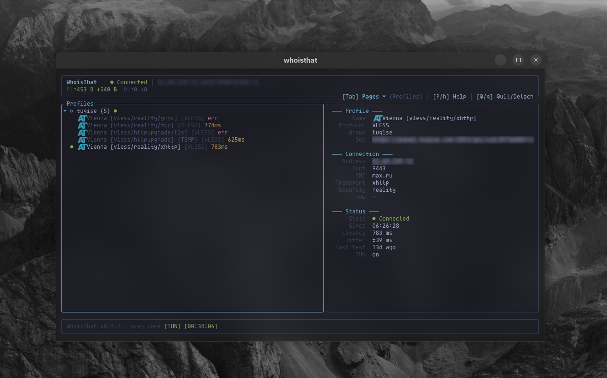
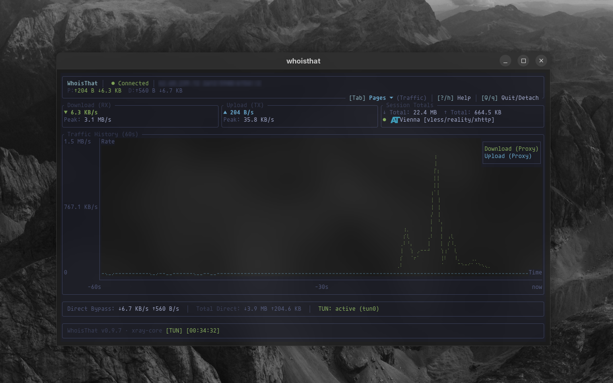

<div style="display: flex; align-items: center; gap: 1.25rem; margin-top: 1rem; margin-bottom: 2rem;">
  
  <div>
    <h1 style="margin: 0; padding: 0; font-size: 2.2rem; font-weight: 800; border: none;">WhoisThat Documentation</h1>
    <p style="margin: 0.35rem 0 0; color: var(--vp-c-text-2); font-size: 1.05rem;">
      Modern terminal-based VPN client for Linux. Rust TUI frontend paired with an autonomous Go engine backed by Xray-core.
    </p>
  </div>
</div>

---

## What is WhoisThat?

**WhoisThat** is a modern, high-performance VPN client built specifically for Linux desktop and server environments. It bridges the gap between bulky Electron applications and complex bare command-line proxies by providing an ergonomic terminal user interface (TUI) backed by a long-running system daemon.

Most day-to-day actions are also available from the terminal:

```bash
whoisthat profile list
whoisthat sub refresh --all
whoisthat settings set split-tunnel=exclude kill-switch=true
whoisthat logs --follow
whoisthat core status
```

```
┌────────────────────────────────────────────────────────┐
│                      User Space                        │
│                                                        │
│  ┌────────────────────────┐    ┌────────────────────┐  │
│  │  whoisthat (Rust TUI)  │    │  CLI & Status API  │  │
│  │  ⋅ Ratatui Interface   │    │  ⋅ Waybar / i3     │  │
│  │  ⋅ Responsive Layout   │    │  ⋅ GNOME Extension │  │
│  └───────────┬────────────┘    └─────────┬──────────┘  │
│              │                           │             │
│              └─────────────┬─────────────┘             │
│                            │                           │
│           Unix Domain Socket / TCP Wire Protocol       │
│           $XDG_RUNTIME_DIR/whoisthat/core.sock         │
│                            │                           │
│                            ▼                           │
│  ┌──────────────────────────────────────────────────┐  │
│  │          whoisthat-core (Go Daemon)              │  │
│  │  ⋅ Encrypted DB (AES-256-GCM)                    │  │
│  │  ⋅ Subscription & HWID Engine                    │  │
│  │  ⋅ TUN & Route Orchestrator                      │  │
│  │  ⋅ Pinned Xray-core Manager (v26.10.31)          │  │
│  └─────────────────────────┬────────────────────────┘  │
└────────────────────────────┼───────────────────────────┘
                             │ Ambient File Capabilities
                             ▼
┌────────────────────────────────────────────────────────┐
│                     Linux Kernel                       │
│  ⋅ Virtual TUN Interface (`whoisthattun`)              │
│  ⋅ nftables / iptables DNAT & MASQUERADE               │
│  ⋅ cgroup v2 Socket Classification (Split Tunnel)      │
│  ⋅ Policy Routing Tables (Table 100 / Table 200)       │
└────────────────────────────────────────────────────────┘
```

---

## Core Pillars & Features

### 1. Rootless Least-Privilege Operation
WhoisThat creates and manages virtual TUN network adapters and policy routing tables without running as `root` or relying on dangerous setuid binaries. Using Linux file capabilities (`cap_net_admin,cap_net_raw,cap_setpcap=+ep`), ambient capabilities are promoted at runtime, keeping user credentials and proxy logic secure.

### 2. Unified Protocol Engine
All modern circumvention and proxy protocols are supported natively through a pinned build of **Xray-core (v26.10.31)**:
* **VLESS**: Reality (TLS certificate camouflage), Vision flow, xHTTP (SplitHTTP), gRPC, and WebSocket transports.
* **Hysteria2**: Native QUIC UDP protocol with Salamander obfuscation and UDP port hopping.
* **VMess**, **Trojan**, **Shadowsocks** (2022 specs), and **SOCKS5**.

### 3. Application-Based Split Tunneling
Bypass the VPN tunnel for gaming, domestic banking, or local network services using pure Linux kernel primitives (cgroup v2 and nftables policy routing). Set **Split tunnel** to `exclude` (apps bypass the VPN) or `include` (only these apps use it) in Settings first — with the default `off`, the commands below do not change routing:
```bash
whoisthat run -d spotify           # Spotify bypasses the VPN tunnel in background
whoisthat run %command%            # In Steam launch options: zero-ping direct gaming
whoisthat run curl 2ip.io          # Runs directly attached in terminal
```
See the [Split Tunneling & Steam Guide](/networking/split-tunnel#gaming-steam-integration) for technical details and setup.

### 4. Rich Routing & Happ Profiles
Define fine-grained routing policies based on domain names, IP subnets, protocols, GeoIP, and GeoSite databases. Ingest provider **Happ routing profiles** (`happ://routing/...`) with per-group routing modes (`auto`, `manual`, `subscription`).

### 5. Encrypted State at Rest
All subscription tokens, server configs, and routing rules are saved locally under `~/.local/share/whoisthat/db/` encrypted with **AES-256-GCM**. The master encryption key is generated automatically with permissions `0600`.

---

## Visual Preview

::: info
The TUN interface is named `whoisthattun` by default. The name is configurable in Settings — the screenshots above use a custom `tun0`.
:::

<div style="display: flex; flex-direction: column; gap: 1.5rem; margin: 1.5rem 0;">
  <div>
    <h4 style="margin-bottom: 0.5rem; color: var(--vp-c-text-2);">Profiles, Tree Navigation & Live Details</h4>
    
  </div>

  <div>
    <h4 style="margin-bottom: 0.5rem; color: var(--vp-c-text-2);">Real-time Traffic Monitoring & Braille Charts</h4>
    
  </div>
</div>

---

## Documentation Roadmap

Get started exploring the documentation:

* **[Installation Guide](/guide/installation)** — Install via the curl script, the Ubuntu PPA, `.deb`/`.rpm` packages, AUR (`whoisthat-bin` or source `whoisthat`), or build from source.
* **[Quick Start Tutorial](/guide/quick-start)** — First launch, importing subscriptions, latency testing, and connecting.
* **[Recipes & Common Setups](/usage/recipes)** — Headless server, proxy-only desktop, per-app bypass, Docker and multi-subscription routing.
* **[Upgrading & Recovery](/guide/upgrading)** — Update, roll back or uninstall; restore settings and profiles after a failure.
* **[Architecture Deep-Dive](/architecture/overview)** — Explore the Go daemon, IPC wire framing, and encryption layer.
* **[TUN Mode & Networking](/networking/tun-mode)** — Learn how rootless TUN, DNS hijacking, and Docker reply conntrack work.
* **[DNS & FakeDNS](/networking/dns)** — Legacy vs Happ resolvers, sink addresses, split-mode behaviour and leak limits.
* **[Routing Precedence](/reference/routing-precedence)** — The canonical first-match order for manual, Happ and JSON routing.
* **[Split Tunneling](/networking/split-tunnel)** — Complete manual on running apps inside cgroup v2 transient slices.
* **[CLI Reference](/reference/cli)** — Command-line flags, selectors, output, and exit codes.
* **[Wire Protocol Reference](/reference/protocol)** — Complete specification of IPC commands and streaming notifications.

---

## Support the Project

WhoisThat is built and maintained in spare time. If it saves you from a bulky desktop client, donations are appreciated.

| Network | Address |
| :--- | :--- |
| **Bitcoin (BTC)** | `bc1qutg32qasdyuuc03l9rtm3uxwncfjafqnhpnnec` |
| **Ethereum (ETH / ERC-20)** | `0x7C643C5b704ADD1888a0F68457cf6b0c5c3508C6` |
| **Tron (TRX / TRC-20)** | `TWSvpXfJsYcDVB9PEwVAgCUXT5RSdtxaYL` |
| **TON (GRAM / jettons)** | `UQAablx88aAbnjXTnU2t6LYoEHIEQeCv6wMqYZaqeoNjSb_x` |
| **Solana (SOL / SPL)** | `DckqFaa2PUikF3eQCt79vzGrg1xCM1j3uYyUNDSsswoX` |

Each address accepts the network's native coin and, where the network supports them, stablecoins (USDT/USDC): ERC-20 on Ethereum, TRC-20 on Tron, SPL on Solana, jettons on TON. The Bitcoin address accepts BTC only.

The native coin of TON is **Gram (GRAM)** — formerly Toncoin (TON). The blockchain is still called TON, and the address is unchanged.
