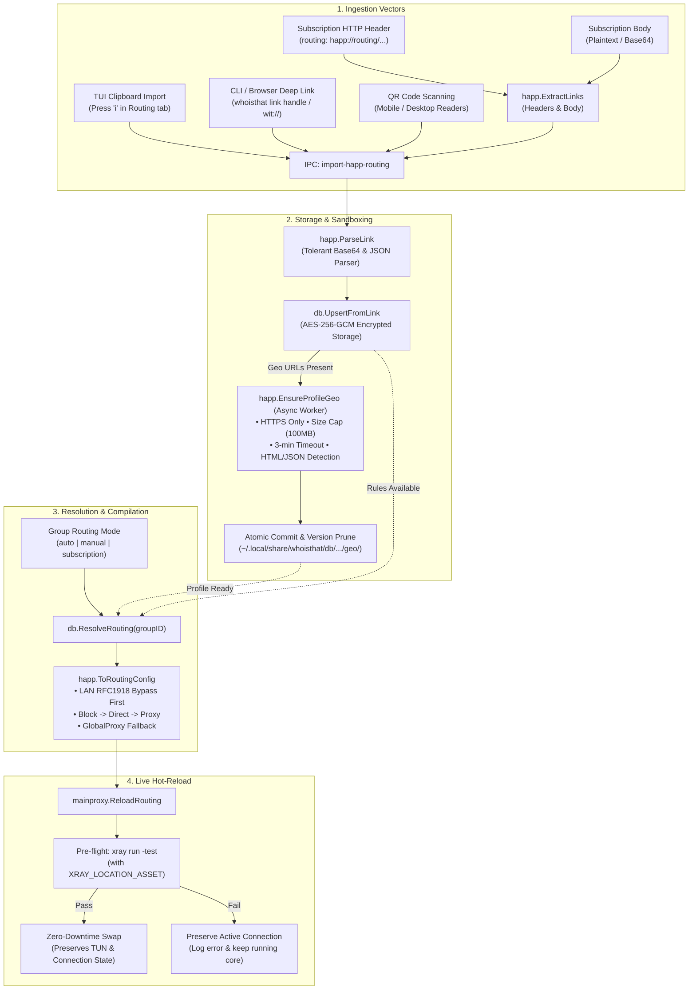
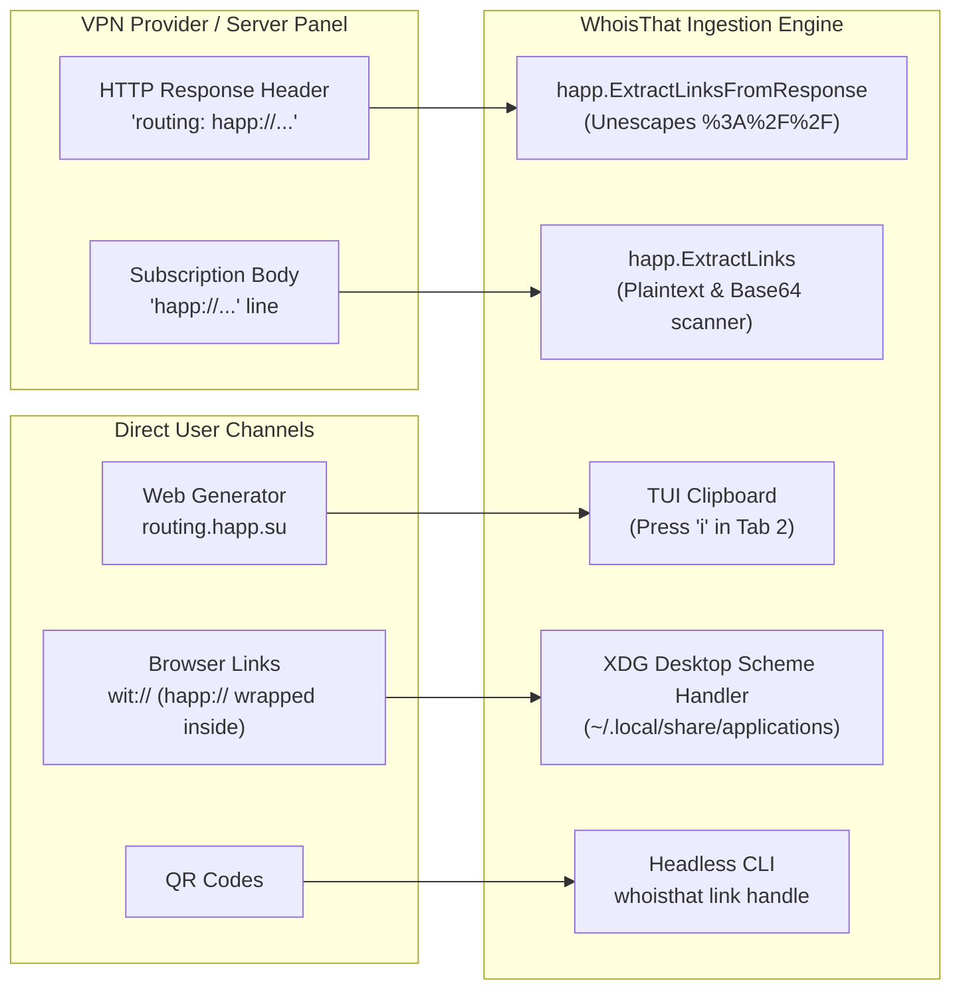

# Happ Routing Profiles

WhoisThat provides native support for **Happ routing profiles** (`happ://routing/...`). Many VPN subscription providers, anti-censorship operators and server panels bundle complex routing configurations — thousands of verified domains, CIDRs, regional rules and custom GeoIP/GeoSite databases — directly inside subscription responses or standalone links.

This page covers how profiles enter the client, how they are scoped to a group, and how to manage them in the TUI. The wire format (URI actions, Base64 decoding, JSON fields, Geo sandbox, IPC payloads) is in [Happ Format Reference](/reference/happ-format).

---

## Architecture Overview

The Happ routing engine is an autonomous pipeline inside `whoisthat-core`, integrated with the encrypted database, the Xray process supervisor and the Rust TUI:



---

## How Happ Routing Enters the Client

Profiles are distributed by providers and generated without manual rule-by-rule configuration on every device.

### 1. Profile Creation & Web Generator

Routing rules can be assembled, visually tested and exported into Happ URIs using the official web generator at **[routing.happ.su](https://routing.happ.su/)**, or authored directly in accordance with the [Happ routing specification](https://www.happ.su/main/dev-docs/routing).

From the generator, administrators define proxy lists, direct sites, blocked resources and custom Geo URLs, then export a ready-to-use `happ://routing/add/{base64}` or `happ://routing/onadd/{base64}` link.

### 2. Delivery Channels

WhoisThat detects all delivery channels defined by the Happ specification:



#### Channel A: HTTP Response Headers (`routing:`)
Subscription servers and management panels (Marzban, Remnawave, 3X-UI, custom billing APIs) attach the routing policy to the HTTP response headers:

```http
HTTP/2 200 OK
Date: Wed, 24 Nov 2024 10:00:52 GMT
Content-Type: application/json
Content-Length: 3798
Content-Disposition: attachment; filename="subscription"
routing: happ://routing/onadd/ewogICAgIk5hbWUiOiAidGVzdCIsCiAgICAiR2xvYmFsUHJveHkiOiAidHJ1ZSIsCiAgICAiRGlyZWN0U2l0ZXMiOiBbXSwKICAgICJEaXJlY3RJcCI6IFtdLAogICAgIlByb3h5U2l0ZXMiOiBbXSwKICAgICJQcm94eUlwIjogW10sCiAgICAiQmxvY2tTaXRlcyI6IFtdLAogICAgIkJsb2NrSXAiOiBbXSwKICAgICJEb21haW5TdHJhdGVneSI6ICJBc0lzIgp9
```

When WhoisThat updates a subscription (<kbd>u</kbd> / <kbd>r</kbd> in the TUI, or `whoisthat sub refresh`), `happ.ExtractLinksFromResponse` reads the `Routing` header, decodes percent-encoded schemes (`happ%3A%2F%2F` ➔ `happ://`) and imports the profile into the matching group.

#### Channel B: Embedded in Subscription Body
The link can sit directly inside the subscription body, on its own line alongside proxy node URIs:

```
happ://routing/onadd/ewogICAgIk5hbWUiOiAidGVzdCIsCiAgICAiR2xvYmFsUHJveHkiOiAidHJ1ZSIs...
vmess://eyJob3N0IjoiZ3VhdmVpc3RhbmJ1bC5jb20iLCJwYXRoIjoiXC8xUyIsInRscyI6InRscyIs...
vless://70cc43c5-b2f4-34ac-a092-d806984a6b8c@1.13.7.91:443?encryption=none&security=reality...
```

* **Plaintext subscriptions**: the parser scans lines for the `happ://routing/` prefix, extracts the link and filters out punctuation.
* **Base64 subscriptions**: if the body is a single Base64 block, `happ.ExtractLinks` decodes it tolerantly and searches the decoded payload for routing links.

#### Channel C: System Clipboard (<kbd>i</kbd> in Routing Tab)
Copy a `happ://routing/...` link from a website, Telegram channel or email and press <kbd>i</kbd> on Tab 2 (*Routing*). The client reads the system clipboard, parses the link and dispatches `import-happ-routing` for the focused group.

#### Channel D: Desktop Deep Links (`wit://`)
Only `wit://` is registered with `xdg-mime` (the TUI writes `~/.local/share/applications/whoisthat-url.desktop` and registers `x-scheme-handler/wit` on launch). A bare `happ://` link in a browser will not launch WhoisThat; use the wrapper or the CLI:

```
wit://happ://routing/add/<BASE64>
wit://routing?link=happ%3A%2F%2Frouting%2Fadd%2F...&group=Premium
whoisthat link handle "happ://routing/add/<BASE64>" --group Premium
```

#### Channel E: Headless CLI & QR Codes
Any link from a QR scanner or script can be ingested from the command line:

```bash
whoisthat link handle "happ://routing/add/<BASE64>" --group "Premium"
whoisthat link handle "happ://routing/onadd/<BASE64>" --group 2

# Legacy alias
whoisthat link handle "happ://routing/add/<BASE64>" --group "Premium"
```

---

## Subscription Lifecycle

### 1. Isolated Per-Subscription Scope
Every group keeps its own Happ profiles, active profile, routing mode and cached Geo assets. Manual rules are different: they live in a **Global** set, and each group either inherits it or keeps a custom override. Changing one group does not affect another.

### 2. Cascading Deletion
Deleting a group purges its Happ profiles and the cached Geo sandbox (`~/.local/share/whoisthat/db/groups/<GID>/routing/geo/`), so no orphaned `.dat` files remain.

### 3. Name-Based Deduplication & Versioning
- A profile with the same name in the same group is updated in place.
- **`LastUpdated` gate**: an incoming profile older than the stored one is ignored, preventing rollback from cached CDN responses.

### 4. Continuity During Updates
When an update arrives, the profile moves to `updating`, new Geo assets download in the background, and the running core keeps serving the old rules. Once assets verify, the profile becomes `ready`; the running connection keeps the previous rules until the profile is activated (or the connection reloads). There is no automatic hot-swap at download completion.

### 5. 7-Day Cooldown
Custom Geo files are gated by a 7-day cooldown (`WeeklyUpdateGate = 604800`), even if the subscription refreshes hourly. This protects provider CDNs.

### 6. Independence from Upstream Clients
WhoisThat supports Happ as an open format but uses its own runtime:

- **In-place reload** (`ReloadRouting`): the Xray process is restarted after a 30 ms pause; the TUN device and routing stay up.
- **Native Linux stack**: rootless TUN via file capabilities, policy routing, nftables marks and cgroup v2 slices.
- **Decoupled control**: for [JSON subscriptions](/networking/json-subscriptions) the provider routing is read-only, but manual rules stay editable and take priority; mode/profile selectors are disabled for those groups.

---

## Rule Compilation & Order of Precedence

WhoisThat's compiler translates a `HappProfile` into a fixed order: LAN → block → direct → proxy, with the `GlobalProxy` catch-all last. The core prepends its structural API and DNS rules and appends manual rules where applicable, so the first matching rule always wins.

The exact order — including manual rules, JSON subscriptions and the `subscription` LAN-only fallback — is in [Routing Precedence](/reference/routing-precedence).

---

## DNS and FakeDNS

When the active Happ profile supplies DNS fields, the core **replaces** Xray's DNS section: `remote-dns` is reached through the proxy, `domestic-dns` directly, and `DnsHosts` plus the resolved VPN server addresses bootstrap the lookup. FakeDNS is applied only in TUN mode with `GlobalProxy=true` and split mode `off`/`exclude`.

The resolver selection table, bootstrap order, fake pools and their limitations are documented in [DNS & FakeDNS](/networking/dns).

---

## Per-Group Routing Modes

Happ profiles, Geo assets and the routing mode are configured **independently for each group**. Pressing <kbd>m</kbd> on the Routing tab cycles `auto → manual → subscription`.

Manual rules have two layers: **Global** (page 0, inherited by default) and **Custom** (a group page, toggled with <kbd>g</kbd>). Editing a rule on an inheriting group switches it to Custom, seeded from the stored override or from Global; switching back keeps the custom file on disk.

The full fallback table — including what happens when the active profile is unusable and how JSON subscriptions differ — is in [Routing Precedence](/reference/routing-precedence#2-then-the-effective-routing-source).

---

## TUI Management Interface

In the TUI on Tab 2 (*Routing*), pressing <kbd>H</kbd> opens the **Happ Routing Profiles** modal:

```
┌───────────────── ⚡ Happ Routing Profiles — Group: Premium [mode: auto] ─────────────────┐
│                                                                                         │
│  ▸ [● Active]  [ready]       Provider Comprehensive Bypass                              │
│        rules: 142 │ strategy: IPIfNonMatch │ updated: 2h ago │ geo: 2h ago              │
│        DNS: DoH cloudflare-dns.com │ DoU 8.8.8.8 │ FakeDNS: on                           │
│                                                                                         │
│    [○ Inactive] [ready]       Streaming & Social Only                                   │
│        rules: 38  │ strategy: AsIs │ updated: 3d ago                                    │
│        DNS: DoH dns.google │ DoU 1.1.1.1                                                 │
│                                                                                         │
│    [○ Inactive] [error]       Custom Regional Rules                                     │
│        rules: 12  │ strategy: IPIfNonMatch │ err: download geoip: HTTP status 404       │
│                                                                                         │
│ ┌─ ⚠ Error Details ───────────────────────────────────────────────────────────────────┐ │
│ │ download geoip from https://cdn.example.com/geo/geoip.dat?...: HTTP status 404      │ │
│ └─────────────────────────────────────────────────────────────────────────────────────┘ │
│                                                                                         │
│       [Enter] Activate  │  [o] Off  │  [d/x] Delete  │  [m] Mode (auto)  │  [Esc] Close │
└─────────────────────────────────────────────────────────────────────────────────────────┘
```

### Keybindings & Controls

| Key | Action | Description |
| :---: | :--- | :--- |
| <kbd>Enter</kbd> | **Activate** | Activates the selected profile for the group. Triggers live hot-reload if connected. |
| <kbd>o</kbd> / <kbd>O</kbd> | **Deactivate** | Sets the active profile to `off`. Falls back to manual rules (in `auto` mode) or safe LAN (in `subscription` mode). |
| <kbd>d</kbd> / <kbd>x</kbd> / <kbd>Del</kbd> | **Delete** | Deletes the profile and purges its versioned Geo sandbox. |
| <kbd>m</kbd> / <kbd>M</kbd> | **Cycle Mode** | Cycles `auto` ➔ `manual` ➔ `subscription`. |
| <kbd>j</kbd> / <kbd>k</kbd> | **Navigate** | Moves the selection cursor. |
| <kbd>Esc</kbd> | **Close** | Dismisses the modal. |

---

## Troubleshooting & Diagnostics

| Diagnostic Symptom | Probable Cause | Technical Fix & Verification |
| :--- | :--- | :--- |
| **Profile displays `[error]` with `HTTP status 404` or `403`** | Remote provider Geo asset URL (`Geoipurl`/`Geositeurl`) is broken or requires authentication. | Verify URL accessibility via `curl -I <url>`. In `auto` mode, WhoisThat automatically falls back to manual rules. |
| **Profile displays `insecure or invalid URL (must be https)`** | Provider configured a plain HTTP URL for custom assets. | HTTPS is strictly required for remote `.dat` files to protect against MITM poisoning. Update the profile or contact the provider. |
| **Profile displays `geo asset exceeds maximum size of 100 MB`** | Provider CDN is serving an oversized archive or corrupted file. | WhoisThat bounds downloads to 100 MiB to prevent disk DoS. Check the asset. |
| **Profile displays `downloaded file is HTML/JSON, not a binary .dat asset`** | Provider CDN returned a Cloudflare challenge, 502 HTML error, or JSON error payload with HTTP 200. | The engine rejected the non-binary payload. Wait for CDN recovery or press <kbd>Enter</kbd> to retry. |
| **Rules do not take effect when connected** | Group mode is set to `manual`. | Press <kbd>m</kbd> in the Happ modal or Routing tab to switch to `auto` or `subscription`. |
| **Cannot activate profile: `geoip.dat missing in ...`** | Asset directory was corrupted or deleted while the daemon was stopped. | Activation validates files first and fails. Refresh the subscription (<kbd>u</kbd>/<kbd>r</kbd>) or re-import the profile, then activate it. |

---

## References & External Links

* [Happ Format Reference](/reference/happ-format) — URI actions, Base64 decoding, payload fields, Geo sandbox and IPC payloads.
* [Happ Developer Documentation: Routing](https://www.happ.su/main/dev-docs/routing) — Upstream protocol reference and schema documentation.
* [Happ Web Rule Builder](https://routing.happ.su/) — Visual editor for crafting and exporting Happ routing profiles.
* [Xray-core Routing Configuration](https://xtls.github.io/config/routing.html) — Reference for underlying routing tags and domain matching mechanics.
