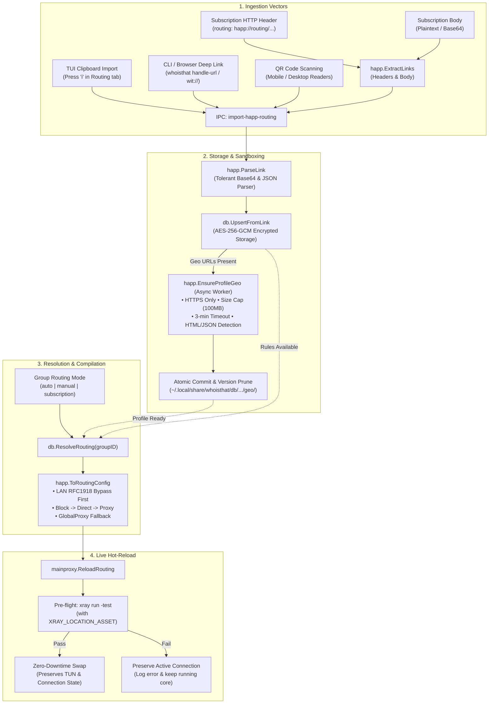
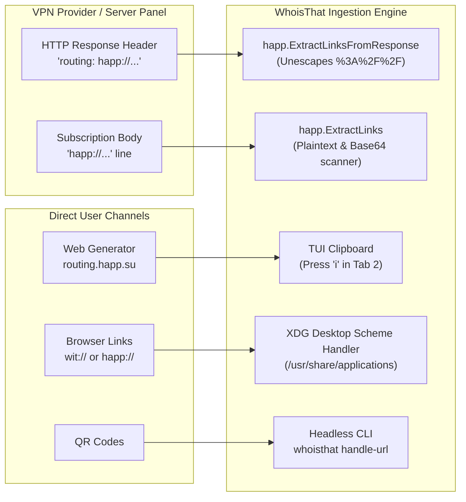
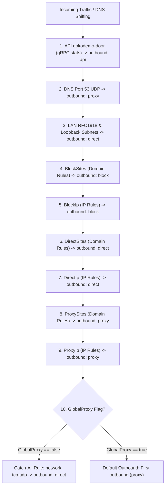
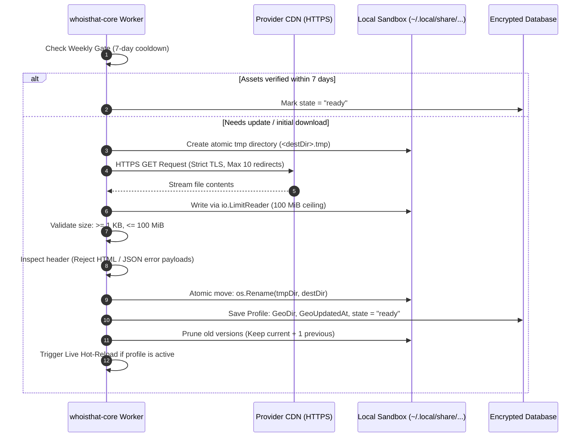

# Happ Routing Profiles & Engine Architecture

WhoisThat provides native, enterprise-grade support for **Happ routing profiles** (`happ://routing/...`). Many modern VPN subscription providers, anti-censorship operators, and server management panels bundle complex routing configurations—containing thousands of verified domains, CIDRs, regional rules, and custom GeoIP/GeoSite databases—directly inside subscription responses or through standalone links.

This document offers an in-depth technical analysis of the Happ routing subsystem, covering how routing profiles enter the client, delivery channels (HTTP headers, body, deep links), URI structure, tolerant decoding algorithms, payload JSON contracts, rule compilation ordering, isolated Geo asset sandboxing, runtime hot-reloading, and per-group routing modes.

---

## Architecture Overview

The Happ routing engine operates as an autonomous pipeline within the `whoisthat-core` daemon, tightly integrated with the encrypted database, the Xray process supervisor, and the Rust TUI frontend:



---

## How Happ Routing Enters the Client

Happ routing profiles are designed to be distributed effortlessly by providers and created by administrators without requiring manual rule-by-rule configuration on every client device.

### 1. Profile Creation & Web Generator

Routing rules can be assembled, visually tested, and exported into Happ URIs using the official web generator at **[routing.happ.su](https://routing.happ.su/)**, or authored directly in accordance with the [Happ routing specification](https://www.happ.su/main/dev-docs/routing).

From the generator, administrators define proxy lists, direct sites, blocked resources, custom Geo URLs, and export a ready-to-use `happ://routing/add/{base64}` or `happ://routing/onadd/{base64}` link.

### 2. Delivery Channels

WhoisThat implements automated detection across all delivery channels defined by the Happ specification:



#### Channel A: HTTP Response Headers (`routing:`)
Subscription servers and management panels (e.g., Marzban, Remnawave, 3X-UI, custom billing APIs) attach the routing policy directly in the HTTP response headers when the client fetches or updates a subscription:

```http
HTTP/2 200 OK
Date: Wed, 24 Nov 2024 10:00:52 GMT
Content-Type: application/json
Content-Length: 3798
Content-Disposition: attachment; filename="subscription"
routing: happ://routing/onadd/ewogICAgIk5hbWUiOiAidGVzdCIsCiAgICAiR2xvYmFsUHJveHkiOiAidHJ1ZSIsCiAgICAiRGlyZWN0U2l0ZXMiOiBbXSwKICAgICJEaXJlY3RJcCI6IFtdLAogICAgIlByb3h5U2l0ZXMiOiBbXSwKICAgICJQcm94eUlwIjogW10sCiAgICAiQmxvY2tTaXRlcyI6IFtdLAogICAgIkJsb2NrSXAiOiBbXSwKICAgICJEb21haW5TdHJhdGVneSI6ICJBc0lzIgp9
```

When WhoisThat updates a subscription (`whoisthat -u` or <kbd>u</kbd> in the TUI), the internal function `happ.ExtractLinksFromResponse` reads the `Routing` header, decodes percent-encoded schemes (`happ%3A%2F%2F` ➔ `happ://`), and immediately imports the profile into the corresponding subscription group.

#### Channel B: Embedded in Subscription Body
The `happ://routing/...` link can be placed directly inside the subscription body, on its own line alongside proxy node URIs:

```
happ://routing/onadd/ewogICAgIk5hbWUiOiAidGVzdCIsCiAgICAiR2xvYmFsUHJveHkiOiAidHJ1ZSIs...
vmess://eyJob3N0IjoiZ3VhdmVpc3RhbmJ1bC5jb20iLCJwYXRoIjoiXC8xUyIsInRscyI6InRscyIs...
vless://70cc43c5-b2f4-34ac-a092-d806984a6b8c@1.13.7.91:443?encryption=none&security=reality...
```

* **Plaintext Subscriptions**: The parser scans lines for the `happ://routing/` prefix, extracts the link, and filters out punctuation.
* **Base64-Encoded Subscriptions**: If the subscription file is a single Base64 block, `happ.ExtractLinks` attempts tolerant Base64 decoding on the entire body and then searches the decoded payload for embedded routing links.

#### Channel C: System Clipboard (<kbd>i</kbd> in Routing Tab)
Users can copy a `happ://routing/...` link from a website, Telegram channel, or email and press <kbd>i</kbd> on Tab 2 (*Routing*). The client reads the system clipboard (via Wayland data-control or X11 selection), parses the link, and dispatches an `import-happ-routing` IPC call targeting the currently focused group.

#### Channel D: Desktop Deep Links (`wit://` & `happ://`)
Clicking links in browsers or applications launches WhoisThat via its registered XDG desktop handler (`x-scheme-handler/wit` and `x-scheme-handler/happ`):

```
wit://happ://routing/add/<BASE64>
wit://routing?link=happ%3A%2F%2Frouting%2Fadd%2F...&group=Premium
happ://routing/add/<BASE64>
```

#### Channel E: Headless CLI & QR Codes
Any link extracted from a QR code scanner or automated script can be ingested via the command line:

```bash
whoisthat handle-url "happ://routing/add/<BASE64>" --group "Premium"
whoisthat handle-url "happ://routing/onadd/<BASE64>" --group 2
```

---

## Decentralization & Subscription Lifecycle

The Happ specification introduces a fundamental shift from monolithic, global client routing to **decentralized, subscription-level management**:

### 1. Isolated Per-Subscription Scope
Every subscription group (including individual manual profiles) maintains its own independent routing profiles, active profile state, and cached Geo assets on disk. Modifying rules in one group has zero effect on other subscriptions.

### 2. Cascading Deletion
When a subscription group is deleted from WhoisThat:
* All associated Happ routing profiles are purged from the database.
* The entire cached Geo sandbox directory on disk (`~/.local/share/whoisthat/db/groups/<GID>/routing/geo/`) is deleted in a cascading manner, ensuring no orphaned `.dat` files consume disk space.

### 3. Name-Based Deduplication & Versioning
* If a routing profile with the same name already exists within the target group, the existing record is updated in-place rather than creating duplicates.
* **`LastUpdated` Timestamp Gate**: If the incoming profile carries a `LastUpdated` Unix timestamp, WhoisThat checks the stored version. If the incoming timestamp is older than the existing one (`incoming.LastUpdated < existing.LastUpdated`), the update is skipped to prevent rollback from cached CDN responses.

### 4. Continuity of Service During Updates
When an update to an existing profile is received:
1. The profile transitions to the `updating` state.
2. New Geo assets begin downloading in the background.
3. **The running proxy core continues serving connections with the old rules and old geofiles.**
4. Once all new assets are verified and compiled, an **atomic swap** occurs, switching Xray to the new version without any dropped packets or connection resets.

### 5. 7-Day Update Cooldown Gate
Geo asset files (`geoip.dat`, `geosite.dat`) are gated by a 7-day cooldown (`WeeklyUpdateGate = 604800` seconds). Even if a subscription is updated every hour, custom Geo files are not re-downloaded unless 7 days have passed since the last successful download, protecting provider CDNs from bandwidth exhaustion.

### 6. Independence of WhoisThat's Technical Architecture
While WhoisThat provides complete support for Happ routing profiles as an open data interchange format, **WhoisThat's technical architecture is completely independent from upstream Happ mobile/desktop clients**:

* **Zero-Downtime Hot-Reload vs Reconnection**: Upstream clients often require tearing down the active connection and reconnecting to apply routing changes. In contrast, WhoisThat executes **in-place atomic hot-reloading** (`ReloadRouting`) in under 30ms without resetting the TUN device or interrupting active network sessions.
* **Native Linux Network Stack**: Rather than generic cross-platform mobile frameworks, WhoisThat's engine is built directly for Linux: rootless TUN via file capabilities (`cap_net_admin`), kernel policy routing (`ip rule`), `nftables` packet marking (`SO_MARK 1`), and `cgroup v2` transient slices.
* **Decoupled User Control**: While upstream clients enforce a "Restricted Mode" that locks controls on provider-managed JSON subscriptions, WhoisThat provides complete user autonomy through its TUI and CLI, allowing inspection, per-group mode switching (`auto`/`manual`/`subscription`), and live rule toggling.

---

## URI Protocol & Action Specifications

Happ routing links use the `happ://routing/` scheme. WhoisThat recognizes three operational actions:

| Action URI | Internal Identifier | Behavior & Core Lifecycle |
| :--- | :--- | :--- |
| `happ://routing/add/{base64}` | `ActionAdd` | Ingests, validates, and stores the routing profile in the target group. If custom Geo assets are specified, initiates background download. Leaves active profile unchanged. |
| `happ://routing/onadd/{base64}` | `ActionOnAdd` | Ingests, validates, and stores the profile. If no custom Geo assets are needed, **immediately activates** the profile. If assets are downloading, marks as pending and activates automatically once compilation finishes. |
| `happ://routing/off` | `ActionOff` | Deactivates the currently active Happ routing profile for the group, clearing `ActiveRoutingProfileId`. |

### Tolerant Base64 Decoder Engine

Real-world subscription servers and messaging apps frequently alter Base64 strings (stripping padding, wrapping lines, converting `+` to spaces, or percent-encoding characters). WhoisThat implements an ultra-tolerant decoding pipeline in `decodeBase64Tolerant`:

1. **Whitespace Cleaning**: Strips all carriage returns (`\r`), newlines (`\n`), tabs (`\t`), and bounding whitespace.
2. **Path Unescaping**: Runs `url.PathUnescape` to convert `%2B` and `%2F` back to characters while preserving literal `+` symbols.
3. **Multi-Format Trial**: Sequentially attempts decoding across 4 standard variants:
   * `base64.StdEncoding` (Standard with padding)
   * `base64.RawStdEncoding` (Standard unpadded)
   * `base64.URLEncoding` (URL-safe `-` and `_` with padding)
   * `base64.RawURLEncoding` (URL-safe unpadded)
4. **Space-to-Plus Heuristic**: If all standard decoders fail and the payload contains spaces, replaces ` ` with `+` and re-runs the decoding matrix.
5. **Payload Size Guard**: Rejects payloads exceeding **1 MiB** (`MaxPayloadBytes = 1048576`) to prevent memory exhaustion attacks.

---

## JSON Payload Specification & Data Contract

Once Base64-decoded, the payload must be a valid UTF-8 JSON document adhering to the `HappProfile` contract:

```json
{
  "Name": "Provider Full Bypass v2",
  "GlobalProxy": true,
  "DomainStrategy": "IPIfNonMatch",
  "DirectSites": [
    "geosite:category-ru",
    "domain:gosuslugi.ru",
    "domain:sberbank.ru"
  ],
  "DirectIp": [
    "geoip:ru",
    "192.168.0.0/16"
  ],
  "ProxySites": [
    "geosite:youtube",
    "geosite:telegram",
    "geosite:openai"
  ],
  "ProxyIp": [
    "geoip:telegram"
  ],
  "BlockSites": [
    "geosite:category-ads-all"
  ],
  "BlockIp": [
    "10.10.10.10/32"
  ],
  "Geoipurl": "https://cdn.provider.com/geo/geoip.dat",
  "Geositeurl": "https://cdn.provider.com/geo/geosite.dat",
  "LastUpdated": 1712345678
}
```

### Field Definitions

| Field | Type | Required | Description |
| :--- | :--- | :---: | :--- |
| **`Name`** | `string` | **Yes** | Human-readable title of the routing profile shown in the TUI and CLI. Whitespace-trimmed. |
| **`GlobalProxy`** | `FlexibleBool` | No | Fallback behavior for unmatched traffic. Defaults to `true` if omitted.<br>• `true`: Unmatched traffic is routed through the proxy tunnel.<br>• `false`: Unmatched traffic exits directly via physical ISP gateway. |
| **`DomainStrategy`** | `string` | No | Xray domain resolution strategy. Normalized to canonical values:<br>• `IPIfNonMatch` *(default)*<br>• `AsIs`<br>• `IPOnDemand` |
| **`DirectSites`** | `[]string` | No | Domains, domain prefixes, and `geosite:` categories that must bypass the VPN. |
| **`DirectIp`** | `[]string` | No | IPv4/IPv6 addresses, CIDR blocks, and `geoip:` categories that must bypass the VPN. |
| **`ProxySites`** | `[]string` | No | Domains and `geosite:` categories forwarded through the VPN tunnel. |
| **`ProxyIp`** | `[]string` | No | IP ranges and `geoip:` categories forwarded through the VPN tunnel. |
| **`BlockSites`** | `[]string` | No | Domains and `geosite:` categories blackholed and dropped. |
| **`BlockIp`** | `[]string` | No | IP addresses and `geoip:` categories blackholed and dropped. |
| **`Geoipurl`** | `string` | No | Remote HTTPS URL from which to download a profile-specific `geoip.dat`. |
| **`Geositeurl`** | `string` | No | Remote HTTPS URL from which to download a profile-specific `geosite.dat`. |
| **`LastUpdated`** | `FlexibleUnix` | No | Epoch timestamp in seconds indicating when the provider generated the profile. |

### Resilient Deserialization Types

To prevent parser panics when interacting with heterogeneous providers, the core uses custom resilient types:

* **`FlexibleBool`**: Safely parses boolean values from JSON booleans (`true`/`false`), quoted strings (`"true"`, `"false"`, `"yes"`, `"no"`), or numeric flags (`1`, `0`).
* **`FlexibleUnix`**: Safely ingests Unix timestamps from numeric integers (`1712345678`), quoted numeric strings (`"1712345678"`), or floating-point numbers. If the field contains garbage (e.g. an ISO string or invalid text), it records a warning, marks `invalid = true`, and falls back to `0` without breaking the entire profile import.

---

## Rule Compilation & Order of Precedence

In Xray-core, routing rules are evaluated **in sequential order from top to bottom**; the first rule that matches a packet terminates evaluation.

WhoisThat's compiler (`ToRoutingConfig` & `injectRoutingConfig`) translates a `HappProfile` into an Xray routing table following a strict security hierarchy:



### Detailed Stage Breakdown

1. **Stats API Loopback**: Injects an internal routing rule for gRPC traffic destined for the Dokodemo-door API inbound. Ensures traffic stats collection never conflicts with user rules.
2. **DNS Leak & Hijack Protection**: Forces all UDP traffic on destination port 53 to the `proxy` outbound. This prevents domain resolution queries from prematurely matching direct rules and leaking unencrypted DNS requests to the local network before domain sniffing occurs.
3. **Private LAN Bypass (Unconditional Priority)**: The private IP subnet rule is hardcoded to execute first:
   ```
   127.0.0.0/8, 10.0.0.0/8, 172.16.0.0/12, 192.168.0.0/16, ::1/128, fc00::/7, fe80::/10 -> direct
   ```
   Guarantees that local network printers, LAN shares, routers, and internal hypervisor interfaces remain reachable regardless of provider wildcard configurations.
4. **Block Rules**: `BlockSites` and `BlockIp` are directed to the `blackhole` protocol outbound.
5. **Direct Rules**: `DirectSites` and `DirectIp` are routed to the `freedom` outbound configured with `SO_MARK = 1` (Table 100), cleanly escaping TUN mode capture without causing routing loops.
6. **Proxy Rules**: `ProxySites` and `ProxyIp` are directed to the encrypted upstream outbound (`proxy`).
7. **Catch-All Default Route**:
   * If `GlobalProxy == false`: A terminal rule matching `network: "tcp,udp"` sends all remaining traffic to `direct`. Only explicitly proxied domains/IPs traverse the VPN tunnel.
   * If `GlobalProxy == true`: Omitted, causing Xray to fall through to the default outbound (the active proxy profile).
8. **Sniffing Route Enforcement**: Sets `routeOnly: false` on inbounds so that SNI-sniffed domain names override raw IP destinations, enabling domain-level routing even when client applications resolve DNS locally.

---

## Per-Group Routing Modes

Routing rules in WhoisThat can be configured **independently for each subscription group**. Pressing <kbd>m</kbd> on the Routing tab cycles the active mode for the focused group:

```
[auto] ──► [manual] ──► [subscription] ──► [auto]
```

### Decision Matrix & Resolution Logic

The resolution algorithm (`resolveRouting`) determines what routing table is applied during connection startup or rule reloading:

| Group Mode | Active Happ Profile Condition | Resulting Routing Source | Effective Behavior |
| :--- | :--- | :--- | :--- |
| **`auto`** *(Default)* | Profile active and assets ready (`state == "ready"`) | **`happ`** | Compiles and enforces the active Happ profile rules. |
| **`auto`** | No active Happ profile, or assets failed/downloading | **`manual`** | **Transparent Fallback**: Seamlessly switches to your manual rules and presets catalog without interrupting traffic. |
| **`manual`** | Any condition | **`manual`** | Strictly enforces user-defined manual rules and presets. All Happ profiles are ignored. |
| **`subscription`** | Profile active and assets ready (`state == "ready"`) | **`happ`** | Strictly compiles and enforces the provider Happ profile. |
| **`subscription`** | Profile missing, inactive, or assets uncompiled | **`happ` (Safe LAN-only)** | **Fail-Safe Isolation**: Instead of exposing manual rules, installs a strict LAN-only bypass rule (`LAN -> direct`). Non-LAN traffic is contained to prevent leaks. |

---

## Isolated Per-Profile Geo Assets Engine

When a Happ profile links to external Geo databases via `Geoipurl` or `Geositeurl`, WhoisThat isolates them inside a dedicated sandbox rather than overwriting global system assets:

```
~/.local/share/whoisthat/db/groups/<GROUP_ID>/routing/geo/<PROFILE_ID>/<VERSION_EPOCH>/
├── geoip.dat
└── geosite.dat
```

### Security & Integrity Pipeline

The background asset manager (`EnsureProfileGeo`) enforces strict safeguards:



### Protection Guarantees

1. **HTTPS Enforcement**: Custom assets must be served over secure TLS. Insecure HTTP URLs and redirects from HTTPS to HTTP are immediately rejected.
2. **Hard Size Boundaries**: Enforces `MinGeoFileSize = 1024` (1 KB) and `MaxGeoFileSize = 104857600` (100 MiB) via `io.LimitReader`. Protects against disk-exhaustion attacks and empty files.
3. **Strict Download Timeout**: Applies a 3-minute hard ceiling per file (`GeoDownloadTimeout = 3 * time.Minute`) via Go `context.WithTimeout`.
4. **Header Sanity Validation**: Reads the initial 16 bytes of every downloaded file. If it detects HTML (`<!doctype`, `<html`) or JSON structures (`{"error"`, `{"code"`), the file is discarded as an invalid CDN error page.
5. **Atomic Commit**: All downloads occur in a staging directory (`.tmp`). Only when both `geoip.dat` and `geosite.dat` have been validated is the directory atomically renamed to the final versioned path.
6. **Version Pruning**: After a successful update, `pruneOldGeoDirs` retains the current version and one previous version (for rollback), deleting older snapshots.
7. **Weekly Cooldown Gate**: Re-downloads are gated by `WeeklyUpdateGate = 604800` (7 days). If valid assets exist and are younger than 7 days, redundant network requests are avoided.
8. **Credential & Query Sanitization**: Provider URLs often carry secret tokens or query parameters. The engine masks queries in logs (`maskURL`) and sanitizes error strings (`sanitizeError`) before transmitting them to the TUI.
9. **Non-Blocking Resilience**: An asset download failure **never terminates an active VPN connection**. The profile is marked with `state: "error"`, its error message is preserved, and the system continues running on previous verified assets or falls back gracefully per the group mode.

---

## Runtime Hot-Reloading & Validation

Whenever an active Happ profile is modified, activated, or finishes downloading Geo assets, `whoisthat-core` reloads Xray-core **in-place without resetting the TUN device** (`ReloadRouting`):

### 1. Asset Environment Binding
The daemon dynamically exports the `XRAY_LOCATION_ASSET` environment variable pointing to the profile's isolated sandbox folder:
```go
if selection.GeoDir != "" {
    cmd.Env = append(os.Environ(), "XRAY_LOCATION_ASSET=" + selection.GeoDir)
}
```

### 2. Pre-Flight Sandbox Verification
Before terminating the running Xray instance, the core tests the compiled configuration against the Xray binary:
```bash
xray run -test
```
* The candidate config is validated in memory via `stdin`.
* If Xray reports a syntax error or a corrupted `.dat` file, the reload is aborted with an error log. **The active VPN connection and network traffic remain completely uninterrupted.**

### 3. Zero-Downtime Swap
* If the pre-flight test passes, the core stops the previous Xray child process and starts the new instance within milliseconds.
* The Linux TUN adapter, system routes, and nftables rules are retained, ensuring SSH sessions and active sockets do not drop.

---

## TUI Management Interface

In the TUI on Tab 2 (*Routing*), pressing <kbd>H</kbd> opens the **Happ Routing Profiles** modal:

```
┌───────────────── ⚡ Happ Routing Profiles — Group: Premium [mode: auto] ─────────────────┐
│                                                                                         │
│  ▸ [● Active]  [ready]       Provider Comprehensive Bypass                              │
│        rules: 142 │ strategy: IPIfNonMatch │ updated: 2h ago │ geo: 2h ago              │
│                                                                                         │
│    [○ Inactive] [ready]       Streaming & Social Only                                   │
│        rules: 38  │ strategy: AsIs │ updated: 3d ago                                    │
│                                                                                         │
│    [○ Inactive] [error]       Custom Regional Rules                                     │
│        rules: 12  │ strategy: IPIfNonMatch │ err: download geoip: HTTP status 404       │
│                                                                                         │
│ ┌─ ⚠ Error Details ───────────────────────────────────────────────────────────────────┐ │
│ │ download geoip from https://cdn.example.com/geo/geoip.dat?...: HTTP status 404      │ │
│ └─────────────────────────────────────────────────────────────────────────────────────┘ │
│                                                                                         │
│       [Enter] Activate  │  [o] Off  │  [d/x] Delete  │  [m] Mode (auto)  │  [Esc] Close │
└─────────────────────────────────────────────────────────────────────────────────────────┘
```

### Keybindings & Controls

| Key | Action | Description |
| :---: | :--- | :--- |
| <kbd>Enter</kbd> | **Activate** | Activates the selected Happ profile for the group. Triggers live hot-reload if the group is connected. |
| <kbd>o</kbd> / <kbd>O</kbd> | **Deactivate** | Sets active Happ profile to `off`. Falls back to manual rules (in `auto` mode) or safe LAN (in `subscription` mode). |
| <kbd>d</kbd> / <kbd>x</kbd> / <kbd>Del</kbd> | **Delete** | Deletes the profile and purges its versioned Geo asset sandbox from disk. |
| <kbd>m</kbd> / <kbd>M</kbd> | **Cycle Mode** | Cycles the group routing mode (`auto` ➔ `manual` ➔ `subscription`). |
| <kbd>j</kbd> / <kbd>k</kbd> | **Navigate** | Moves selection cursor down / up. |
| <kbd>Esc</kbd> | **Close** | Dismisses the Happ profiles modal. |

---

## IPC Wire Protocol Specification

Frontends communicate Happ operations with `whoisthat-core` via length-prefixed JSON IPC messages:

### 1. `import-happ-routing`
Imports a raw `happ://routing/...` link into a group.
* **Payload**:
  ```json
  {
    "group_id": 1,
    "link": "happ://routing/add/eyJOYW1lIjoiVGVzdCIs...}"
  }
  ```
* **Response**: Emits `subscription-updated` on success, or `warn` (`key: "import-happ-routing-failed"`) on error.

### 2. `set-group-routing-mode`
Configures the routing mode for a group.
* **Payload**:
  ```json
  {
    "group_id": 1,
    "mode": "auto"
  }
  ```
* **Response**: Emits `group-updated` and triggers `proxy_manager.ReloadRouting` if connected.

### 3. `set-active-routing-profile`
Selects the active Happ profile for a group.
* **Payload**:
  ```json
  {
    "group_id": 1,
    "profile_id": "c1f7b82e9a"
  }
  ```
  *(Pass `"profile_id": "off"` or `""` to deactivate).*
* **Response**: Emits `group-updated`, initiates Geo compilation if needed, and hot-reloads live routing.

### 4. `delete-routing-profile`
Permanently deletes a profile and its on-disk Geo sandbox.
* **Payload**:
  ```json
  {
    "group_id": 1,
    "profile_id": "c1f7b82e9a"
  }
  ```
* **Response**: Emits `subscription-updated`. If the deleted profile was active, cleanly reloads routing.

---

## Troubleshooting & Diagnostics

| Diagnostic Symptom | Probable Cause | Technical Fix & Verification |
| :--- | :--- | :--- |
| **Profile displays `[error]` with `HTTP status 404` or `403`** | Remote provider Geo asset URL (`Geoipurl`/`Geositeurl`) is broken or requires authentication. | Verify URL accessibility via `curl -I <url>`. In `auto` mode, WhoisThat automatically falls back to manual rules. |
| **Profile displays `insecure or invalid URL (must be https)`** | Provider configured a plain HTTP URL for custom assets. | HTTPS is strictly required for remote `.dat` files to protect against MITM poisoning. Update profile or contact provider. |
| **Profile displays `geo asset exceeds maximum size of 100 MB`** | Provider CDN is serving an oversized archive or corrupted file. | WhoisThat bounds asset downloads to 100 MiB to prevent disk DoS. Check asset contents. |
| **Profile displays `downloaded file is HTML/JSON, not a binary .dat asset`** | Provider CDN returned a Cloudflare challenge, 502 HTML error, or JSON error payload with HTTP 200. | The engine rejected the non-binary payload. Wait for provider CDN recovery or press <kbd>Enter</kbd> to retry. |
| **Rules do not take effect when connected** | Group mode is set to `manual`. | Press <kbd>m</kbd> in the Happ modal or Routing tab to switch the group mode to `auto` or `subscription`. |
| **Cannot activate profile: `geoip.dat missing in ...`** | Asset directory was corrupted or deleted while daemon was stopped. | Selecting the profile with <kbd>Enter</kbd> triggers an automatic re-download and re-compilation. |
 
---

## References & External Links

* [Happ Developer Documentation: Routing](https://www.happ.su/main/dev-docs/routing) — Upstream protocol reference and schema documentation.
* [Happ Web Rule Builder](https://routing.happ.su/) — Visual editor for crafting and exporting Happ routing profiles.
* [Xray-core Routing Configuration](https://xtls.github.io/config/routing.html) — Reference for underlying routing tags and domain matching mechanics.

