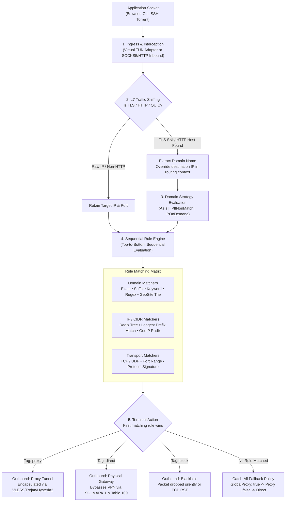
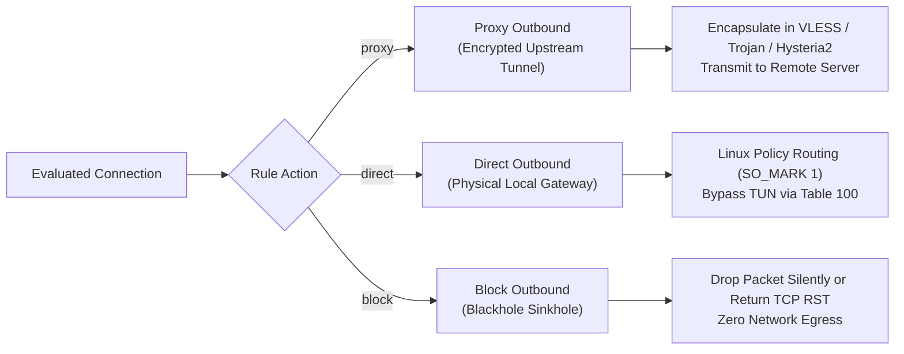

# Routing Engine Architecture & Principles

Modern proxy circumvention and virtual private networking have evolved far beyond naive "global VPN" tunnels. In a modern network environment, routing all traffic unconditionally through a remote proxy introduces unnecessary latency for domestic services, triggers anti-fraud blocks on local banking portals, and saturates encrypted tunnels with heavy, non-restricted data streams (such as OS updates and Steam downloads).

**Intelligent Routing** is the technology that classifies network traffic in real time at Layers 3, 4, and 7, directing each connection along its optimal path: through an encrypted proxy tunnel, directly out via the local ISP gateway, or into a blackhole.

This document explores the fundamental engineering principles of routing as a networking technology, its packet-processing lifecycle, domain-sniffing algorithms, DNS resolution strategies, and how WhoisThat natively executes these principles on Linux.

---

## The End-to-End Packet Lifecycle

When an application initiates a network connection, traffic traverses a multi-stage classification and forwarding pipeline before a single byte leaves the machine:



---

## Core Technologies of Modern Routing

### 1. Ingress & Interception (Layer 3 vs Layer 4)
Traffic enters the routing engine through one of two mechanisms:
* **Layer 3 (TUN Virtual Network Interface)**: Operating at the IP packet level, a virtual TUN device (such as `whoisthat0`) captures all operating system IP datagrams. This captures every protocol (TCP, UDP, ICMP) system-wide without requiring application-level proxy configuration.
* **Layer 4 (Loopback Proxy Inbounds)**: Local SOCKS5 (`127.0.0.1:10808`) and HTTP (`127.0.0.1:10809`) listeners accept proxy connections explicitly forwarded by browsers or command-line utilities.

### 2. Deep Packet Inspection & Domain Sniffing
In modern Content Delivery Networks (CDNs) and Anycast architectures (Cloudflare, Fastly, Akamai), tens of thousands of completely unrelated websites share the exact same IP address. If a routing engine only matched destination IP addresses, it would be impossible to split traffic (e.g. routing `blocked-site.org` through the proxy while sending `banking-site.ru` directly, when both resolve to the same Cloudflare IP).

**Domain Sniffing** solves this dilemma by inspecting the initial handshake payload of a connection:
* **TLS Connections**: The engine peeks into the client's `ClientHello` packet and extracts the **Server Name Indication (SNI)** extension.
* **HTTP Connections**: The engine reads the initial HTTP request line and extracts the `Host:` header.
* **QUIC / HTTP/3**: The engine inspects the initial QUIC crypto frames to identify the server name.

By configuring `sniffing.routeOnly = false`, the routing engine replaces the destination IP address with the extracted domain name in the connection context, allowing domain-level rules to evaluate accurately even when the operating system resolved the address locally.

### 3. DNS Resolution Strategies (`DomainStrategy`)
Routing creates a circular dependency:
* To route by **domain**, the client needs to know the domain name.
* To route by **IP**, the client needs the resolved IP address.
* But resolving the domain via local DNS before routing risks leaking private queries and receiving poisoned or regional CDN responses.

The routing engine resolves this using formal domain strategies:

| Strategy | Operational Principle | Trade-Off & Use Case |
| :--- | :--- | :--- |
| **`AsIs`** | Evaluates domain rules against domain targets, and IP rules against IP targets, without performing any intermediary DNS resolution. | **Maximum Speed**: Zero DNS latency overhead. However, IP rules cannot match domain connections, and domain rules cannot match raw IP traffic. |
| **`IPIfNonMatch`** *(Recommended)* | Evaluates domain rules first. If no domain rule matches the connection, the engine queries its internal DNS resolver to obtain the domain's IP addresses and re-evaluates the IP rules against the resolved addresses. | **Optimal Precision**: Prevents unnecessary DNS queries for explicitly proxied or bypassed domains, while ensuring regional GeoIP rules still apply to domain traffic. |
| **`IPOnDemand`** | As soon as a domain connection enters routing, it is immediately resolved to an IP address, and both domain and IP rules are evaluated simultaneously. | Ensures maximum rule coverage, but introduces resolution latency on every initial domain lookup. |

#### DNS Loop & Leak Prevention
To prevent circular routing loops (where DNS queries for a blocked site get routed through a rule that itself needs DNS), the routing engine explicitly prioritizes all UDP traffic on port 53 directly to the `proxy` outbound before user rules are evaluated. This guarantees that name resolution always occurs securely inside the encrypted tunnel.

### 4. Rule Classification Engines

When evaluating candidate packets, the routing engine uses specialized data structures optimized for sub-millisecond lookup times:

#### A. Domain Matching Matrix
Domains are checked against a hierarchy of rule matchers:
1. **Full Match (`domain:` or `full:`)**: Strict exact equality (`domain:example.com` matches only `example.com`).
2. **Suffix Match (`domain:`)**: Subdomain tree match (`example.com` matches `api.example.com`, `auth.api.example.com`, and `example.com`).
3. **Keyword Match (`keyword:`)**: Substring search (`keyword:google` matches any domain containing the word "google").
4. **Regular Expression (`regexp:`)**: Arbitrary regex evaluation for complex domain patterns.
5. **GeoSite Trie (`geosite:<category>`)**: Compiled binary Protobuf trees (`geosite.dat`). Tens of thousands of categorized domains (e.g. `category-ads-all`, `youtube`, `netflix`) are pre-compiled into a memory-efficient radix tree, allowing instant classification.

#### B. IP / CIDR Matching Matrix
IP addresses are evaluated using **Longest Prefix Match (LPM)** algorithms:
1. **Exact IP Match**: Single IPv4 (`1.1.1.1`) or IPv6 (`2606:4700::1111`) match.
2. **CIDR Subnet Match**: Classless Inter-Domain Routing blocks (`192.168.0.0/16`, `10.0.0.0/8`) evaluated via a Radix/PATRICIA trie.
3. **GeoIP Regional Databases (`geoip:<country>`)**: Compiled binary databases (`geoip.dat`) mapping global IPv4/IPv6 address allocations into country codes (`geoip:ru`, `geoip:us`) and special network categories (`geoip:private` for RFC1918 subnets).

### 5. Outbound Actions & Dispatch

Every evaluated packet is dispatched to one of three destination targets:



* **`proxy`**: Connection data is encrypted and encapsulated into the active proxy protocol (VLESS with Reality/Vision, Trojan, VMess, Hysteria2) and forwarded to the remote VPN server.
* **`direct`**: Connection data bypasses the proxy entirely. On Linux, this requires sophisticated kernel routing: the direct outbound socket sets an fwmark (`SO_MARK = 1`), and policy routing rules (`ip rule add fwmark 1 table 100`) route the packets through the physical interface gateway, preventing an infinite loop back into the TUN device.
* **`block`**: Connection data is routed to a blackhole outbound. Inbound requests are immediately dropped or answered with a TCP RST, terminating ad-trackers, telemetry, and malicious domains before any network packets leave the interface.

### 6. Fallback & Catch-All Policies
When a packet does not match any explicit rule in the routing table, the system applies a terminal fallback policy governed by the `GlobalProxy` parameter:

* **Tunnel-First (`GlobalProxy: true`)**: All unmatched traffic defaults to the `proxy` outbound. This ensures maximum privacy: only explicitly whitelisted services exit directly.
* **Direct-First / Split-by-Exception (`GlobalProxy: false`)**: All unmatched traffic defaults to `direct`. Only explicitly proxied domains and IP ranges enter the VPN tunnel.

---

## WhoisThat's Native Linux Implementation

While routing concepts are universal across proxy platforms, WhoisThat's implementation is engineered specifically for Linux systems:

```
┌────────────────────────────────────────────────────────┐
│                   WhoisThat TUI & CLI                  │
│    • Presets Catalog (<kbd>p</kbd>) • Interactive Rule Editor (<kbd>a</kbd>/<kbd>e</kbd>)   │
│    • Global / Per-Group Rule Pages (<kbd>g</kbd>) • Mode Switcher (<kbd>m</kbd>)           │
└───────────────────────────┬────────────────────────────┘
                            │ Length-Prefixed IPC (UDS)
┌───────────────────────────▼────────────────────────────┐
│                  whoisthat-core (Go)                   │
│    • Policy Resolution & Geo Asset Sandbox Manager     │
│    • nftables Firewall Engine (SO_MARK 1, Kill-Switch) │
│    • Rootless TUN Device (cap_net_admin capabilities)  │
│    • cgroup v2 Split Tunnel Launcher (systemd scope)   │
└───────────────────────────┬────────────────────────────┘
                            │ Memory Pre-Flight (xray run -test)
                            │ XRAY_LOCATION_ASSET Environment
┌───────────────────────────▼────────────────────────────┐
│                    Xray-core Process                   │
│    • In-Place Sub-30ms Hot-Reload (Zero TUN Downtime)  │
│    • High-Performance Protobuf GeoIP/GeoSite Matching  │
└────────────────────────────────────────────────────────┘
```

### Key Linux Engineering Highlights:

1. **Rootless System TUN**: Operates without root daemon execution. The core binary leverages Linux file capabilities (`cap_net_admin,cap_net_raw,cap_setpcap`) to manage virtual network interfaces, system routing tables, and firewall rules cleanly.
2. **Sub-30ms Zero-Downtime Hot-Reloading**: Unlike clients that tear down the virtual network interface or disconnect the VPN whenever a rule changes, WhoisThat validates new routing configurations in-memory (`xray run -test`) and reloads the routing engine in-place. Active SSH sessions, streams, and downloads remain uninterrupted.
3. **cgroup v2 Split Tunneling Integration**: Complementing domain and IP routing, WhoisThat features application-level routing via `whoisthat run <app>`. Sockets launched inside `whoisthat_split.slice` are matched by kernel nftables rules using cgroup v2 path hierarchies, allowing per-application bypass or enforcement.
4. **Decoupled Architecture**: Rule policies (whether created manually, toggled via presets, or imported from external profile links) are stored in an encrypted database (`~/.local/share/whoisthat/db`) using AES-256-GCM.

---

## Global Rules and Per-Group Overrides

The Routing tab is paginated: page 0 is **Global**, followed by one page per subscription group. Use <kbd>←</kbd> / <kbd>→</kbd> (or <kbd>h</kbd> / <kbd>l</kbd>) to move between pages.

Manual rules have two layers:

* **Global** — the shared rule set shown on page 0. It is stored in `~/.local/share/whoisthat/db/routing.json` and is used by every group that inherits it.
* **Custom** — a group-specific rule set stored in `~/.local/share/whoisthat/db/groups/<GID>/routing/manual.json`.

A group's `manual_routing_mode` decides which layer applies:

| Value | Behavior |
| :--- | :--- |
| `inherit` (default, also stored as an empty value) | The group uses the Global rules. |
| `custom` | The group uses its own rule set instead of Global. |

Press <kbd>g</kbd> on a group page to switch between the two. Switching to **Custom** seeds the group with a copy of Global if no custom rules exist yet. Switching back to **Global** keeps the custom file on disk, so the rules return when Custom is enabled again.

Editing a rule (add / edit / delete / toggle / preset) on a group page that still inherits Global automatically creates the custom override, seeded from the stored custom rules if present, otherwise from Global.

The effective manual layer is resolved by `resolveRouting`:

* `manual` mode and fallbacks in `auto` mode use the group's custom rules when `manual_routing_mode == "custom"`, otherwise the Global rules.
* `subscription` mode never applies manual rules; it falls back to the LAN-only fail-safe instead.

---

## Supported Rule Match Types

WhoisThat supports six distinct matching criteria in manual and imported rules:

| Type | Internal Field | Description & Syntax Example |
| :--- | :--- | :--- |
| **`domain`** | `rule.domain` | Matches full domain or subdomain suffix: `example.com`, `sub.domain.org`. |
| **`ip`** | `rule.ip` | Individual IP addresses or CIDR network blocks: `1.2.3.4`, `192.168.1.0/24`. |
| **`protocol`** | `rule.protocol` | Protocol signature matching: `bittorrent`, `tls`, `http`. |
| **`port`** | `rule.port` | Destination port or range: `443`, `80,443`, `8000-8080`. |
| **`geoip`** | `geoip:<country>` | Country or geographic IP database lookup: `geoip:private`, `geoip:ru`, `geoip:us`. |
| **`geosite`** | `geosite:<category>`| Curated domain lists from v2fly: `geosite:category-ads-all`, `geosite:youtube`, `geosite:telegram`. |

---

## The Presets Catalog (<kbd>p</kbd>)

Press <kbd>p</kbd> in the Routing tab to open the built-in **Routing Presets Catalog**. Each preset can be toggled on or off with a single keystroke:

```
┌──────────────────────── Routing Presets Catalog ────────────────────────┐
│                                                                        │
│  [X] 🇷🇺 Bypass Russia       Direct access to Russian domains & IPs     │
│  [X] 🛡️ Block Ads & Trackers Drop ad servers and telemetry networks    │
│  [X] 🏠 Bypass LAN / Local   Direct access to private RFC1918 subnets   │
│  [X] 📺 Proxy Media          Route YouTube, Twitch, and Discord         │
│  [X] 💬 Proxy Telegram       Route official Telegram domains and CIDRs  │
│  [X] 🤖 Proxy AI Services    Route OpenAI and Anthropic / Claude        │
│  [X] 📸 Proxy Blocked Socials Route Twitter/X, Instagram, and Meta      │
│                                                                        │
│             [Press Space/Enter to Toggle • Esc to Close]               │
│                                                                        │
│  [a] Apply Rules  │  [d] Delete Preset Rules  │  [Esc] Close           │
└────────────────────────────────────────────────────────────────────────┘
```

### Preset Definitions:

* **🇷🇺 Bypass Russia**: Directs `geosite:category-ru` and `geoip:ru` to `direct`.
* **🛡️ Block Ads & Trackers**: Directs `geosite:category-ads-all` to `block`.
* **🏠 Bypass LAN / Local**: Directs RFC1918 subnets (`10.0.0.0/8`, `172.16.0.0/12`, `192.168.0.0/16`, `127.0.0.0/8`) to `direct`.
* **📺 Proxy Media**: Directs `geosite:youtube`, `geosite:twitch`, `geosite:discord` to `proxy`.
* **💬 Proxy Telegram**: Directs `geosite:telegram` and `geoip:telegram` to `proxy`.
* **🤖 Proxy AI Services**: Directs `geosite:openai`, `domain:anthropic.com`, `domain:claude.ai` to `proxy`.
* **📸 Proxy Blocked Socials**: Directs `geosite:twitter`, `geosite:instagram`, `geosite:facebook` to `proxy`.

---

## GeoIP & GeoSite Database Pipeline

WhoisThat automates database lifecycle management for `geoip.dat` and `geosite.dat`:
1. Databases are stored globally in `~/.config/whoisthat/geo/` (or isolated per-profile in `~/.local/share/whoisthat/db/.../geo/` when using custom profile assets).
2. On startup, files are verified for presence and binary integrity.
3. If missing, global assets are automatically downloaded from official [v2fly releases](https://github.com/v2fly/domain-list-community/releases).
4. The core performs an in-memory configuration test (`xray run -test`) with a baseline `geoip:private` verification rule before committing routes to the network stack.
