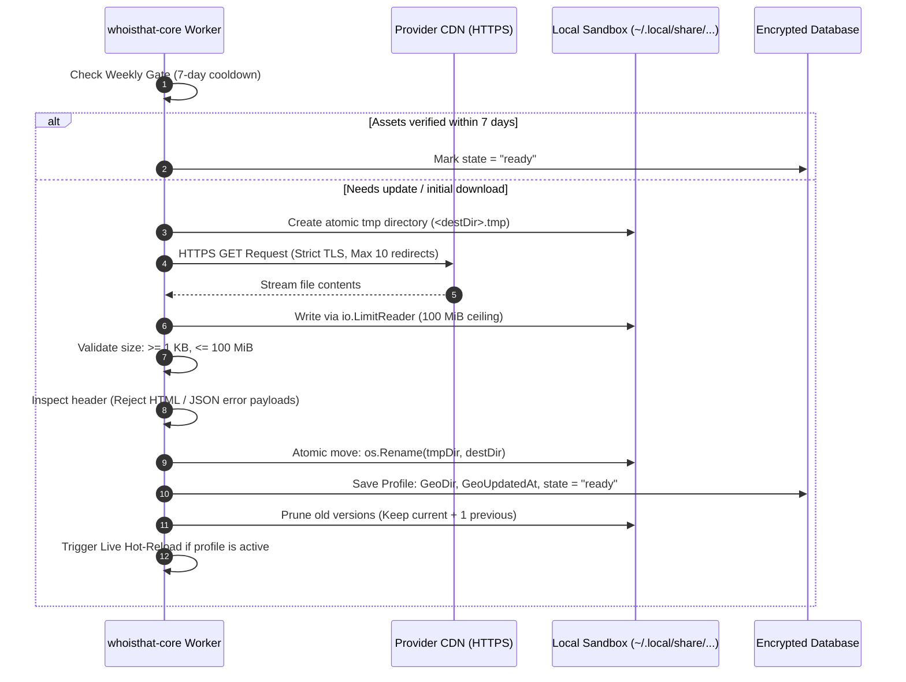

# Happ Format Reference

Technical specification of the `happ://routing/...` payload consumed by WhoisThat: URI actions, tolerant Base64 decoding, the JSON contract, the isolated Geo sandbox and the IPC messages that drive it. For importing profiles and managing modes in the UI, see [Happ Routing Profiles](/networking/happ-routing).

---

## URI Protocol & Action Specifications

Happ routing links use the `happ://routing/` scheme. WhoisThat recognizes three operational actions:

| Action URI | Internal Identifier | Behavior & Core Lifecycle |
| :--- | :--- | :--- |
| `happ://routing/add/{base64}` | `ActionAdd` | Ingests, validates, and stores the routing profile in the target group. If custom Geo assets are specified, initiates background download. Activates the profile only if the group has no active profile yet; it never replaces an existing active one. |
| `happ://routing/onadd/{base64}` | `ActionOnAdd` | Ingests, validates, and stores the profile. If no custom Geo assets are needed, **immediately activates** it. If assets must be downloaded, the profile is stored in the `updating` state; there is no automatic activation after the download — select it with <kbd>Enter</kbd> once it is `ready`. |
| `happ://routing/off` | `ActionOff` | Deactivates the currently active Happ routing profile for the group, clearing `ActiveRoutingProfileId`. |

### Tolerant Base64 Decoder Engine

Real-world subscription servers and messaging apps frequently alter Base64 strings (stripping padding, wrapping lines, converting `+` to spaces, or percent-encoding characters). WhoisThat implements an ultra-tolerant decoding pipeline in `decodeBase64Tolerant`:

1. **Whitespace Cleaning**: Strips all carriage returns (`\r`), newlines (`\n`), tabs (`\t`), and bounding whitespace.
2. **Path Unescaping**: Runs `url.PathUnescape` to convert `%2B` and `%2F` back to characters while preserving literal `+` symbols.
3. **Multi-Format Trial**: Sequentially attempts decoding across 4 standard variants:
   * `base64.StdEncoding` (Standard with padding)
   * `base64.RawStdEncoding` (Standard unpadded)
   * `base64.URLEncoding` (URL-safe `-` and `_` with padding)
   * `base64.RawURLEncoding` (URL-safe unpadded)
4. **Space-to-Plus Heuristic**: If all standard decoders fail and the payload contains spaces, replaces ` ` with `+` and re-runs the decoding matrix.
5. **Payload Size Guard**: Rejects payloads exceeding **1 MiB** (`MaxPayloadBytes = 1048576`) to prevent memory exhaustion attacks.

---

## JSON Payload Specification & Data Contract

Once Base64-decoded, the payload must be a valid UTF-8 JSON document adhering to the `HappProfile` contract:

```json
{
  "Name": "Provider Full Bypass v2",
  "GlobalProxy": true,
  "DomainStrategy": "IPIfNonMatch",
  "DirectSites": [
    "geosite:category-ru",
    "domain:gosuslugi.ru",
    "domain:sberbank.ru"
  ],
  "DirectIp": [
    "geoip:ru",
    "192.168.0.0/16"
  ],
  "ProxySites": [
    "geosite:youtube",
    "geosite:telegram",
    "geosite:openai"
  ],
  "ProxyIp": [
    "geoip:telegram"
  ],
  "BlockSites": [
    "geosite:category-ads-all"
  ],
  "BlockIp": [
    "10.10.10.10/32"
  ],
  "Geoipurl": "https://cdn.provider.com/geo/geoip.dat",
  "Geositeurl": "https://cdn.provider.com/geo/geosite.dat",
  "RemoteDNSType": "DoH",
  "RemoteDNSDomain": "https://cloudflare-dns.com/dns-query",
  "RemoteDNSIP": "1.1.1.1",
  "DomesticDNSType": "DoU",
  "DomesticDNSDomain": "",
  "DomesticDNSIP": "8.8.8.8",
  "DnsHosts": {
    "vpn.provider.com": "203.0.113.7"
  },
  "FakeDNS": "false",
  "LastUpdated": 1712345678
}
```

### Field Definitions

| Field | Type | Required | Description |
| :--- | :--- | :---: | :--- |
| **`Name`** | `string` | **Yes** | Human-readable title of the routing profile shown in the TUI and CLI. Whitespace-trimmed. |
| **`GlobalProxy`** | `FlexibleBool` | No | Fallback behavior for unmatched traffic. Defaults to `true` if omitted.<br>• `true`: Unmatched traffic is routed through the proxy tunnel.<br>• `false`: Unmatched traffic exits directly via physical ISP gateway. |
| **`DomainStrategy`** | `string` | No | Xray domain resolution strategy. Normalized to canonical values:<br>• `IPIfNonMatch` *(default)*<br>• `AsIs`<br>• `IPOnDemand` |
| **`DirectSites`** | `[]string` | No | Domains, domain prefixes, and `geosite:` categories that must bypass the VPN. |
| **`DirectIp`** | `[]string` | No | IPv4/IPv6 addresses, CIDR blocks, and `geoip:` categories that must bypass the VPN. |
| **`ProxySites`** | `[]string` | No | Domains and `geosite:` categories forwarded through the VPN tunnel. |
| **`ProxyIp`** | `[]string` | No | IP ranges and `geoip:` categories forwarded through the VPN tunnel. |
| **`BlockSites`** | `[]string` | No | Domains and `geosite:` categories blackholed and dropped. |
| **`BlockIp`** | `[]string` | No | IP addresses and `geoip:` categories blackholed and dropped. |
| **`Geoipurl`** | `string` | No | Remote HTTPS URL from which to download a profile-specific `geoip.dat`. |
| **`Geositeurl`** | `string` | No | Remote HTTPS URL from which to download a profile-specific `geosite.dat`. |
| **`RemoteDNSType`** | `string` | No | Tunnel DNS transport: `DoH` or `DoU`. If omitted, inferred from the populated fields. |
| **`RemoteDNSDomain`** | `string` | No | DoH URL, normalized to `https://host[/path]`. |
| **`RemoteDNSIP`** | `string` | No | Literal IP used for DoU and as the DoH bootstrap entry. |
| **`DomesticDNSType`** | `string` | No | Direct DNS transport: `DoH` or `DoU`. |
| **`DomesticDNSDomain`** | `string` | No | Domestic DoH URL. |
| **`DomesticDNSIP`** | `string` | No | Domestic DoU address / DoH bootstrap IP. |
| **`DnsHosts`** | `object` | No | Static `domain -> literal IP` mappings copied into Xray's `dns.hosts`. Invalid entries are ignored with a warning. |
| **`FakeDNS`** | `FlexibleBool` | No | Provider preference for fake IPs. Active only with TUN + `GlobalProxy=true` and split mode `off`/`exclude`. In proxy mode, `include`, and `GlobalProxy=false` it is parsed and stored but not applied. |
| **`LastUpdated`** | `FlexibleUnix` | No | Epoch timestamp in seconds indicating when the provider generated the profile. |

DNS values are validated defensively. A malformed DoH URL or non-IP DoU address produces a warning and a safe fallback instead of rejecting the entire routing profile. Profiles created before DNS support are decoded lazily from their stored raw JSON, so re-importing is not required.

### Resilient Deserialization Types

To prevent parser panics when interacting with heterogeneous providers, the core uses custom resilient types:

* **`FlexibleBool`**: Safely parses boolean values from JSON booleans (`true`/`false`), quoted strings (`"true"`, `"false"`, `"yes"`, `"no"`), or numeric flags (`1`, `0`).
* **`FlexibleUnix`**: Safely ingests Unix timestamps from numeric integers (`1712345678`), quoted numeric strings (`"1712345678"`), or floating-point numbers. If the field contains garbage (e.g. an ISO string or invalid text), it records a warning, marks `invalid = true`, and falls back to `0` without breaking the entire profile import.

---

## Isolated Per-Profile Geo Assets Engine

When a Happ profile links to external Geo databases via `Geoipurl` or `Geositeurl`, WhoisThat isolates them inside a dedicated sandbox rather than overwriting global system assets:

```
~/.local/share/whoisthat/db/groups/<GROUP_ID>/routing/geo/<PROFILE_ID>/<VERSION_EPOCH>/
├── geoip.dat
└── geosite.dat
```

### Security & Integrity Pipeline

The background asset manager (`EnsureProfileGeo`) enforces strict safeguards:



### Protection Guarantees

1. **HTTPS Enforcement**: Custom assets must be served over secure TLS. Insecure HTTP URLs and redirects from HTTPS to HTTP are immediately rejected.
2. **Hard Size Boundaries**: Enforces `MinGeoFileSize = 1024` (1 KB) and `MaxGeoFileSize = 104857600` (100 MiB) via `io.LimitReader`. Protects against disk-exhaustion attacks and empty files.
3. **Strict Download Timeout**: Applies a 3-minute hard ceiling per file (`GeoDownloadTimeout = 3 * time.Minute`) via Go `context.WithTimeout`.
4. **Header Sanity Validation**: Reads the initial 16 bytes of every downloaded file. If it detects HTML (`<!doctype`, `<html`) or a JSON object (`{`), the file is discarded as an invalid CDN error page.
5. **Atomic Commit**: All downloads occur in a staging directory (`.tmp`). Only when both `geoip.dat` and `geosite.dat` have been validated is the directory atomically renamed to the final versioned path.
6. **Version Pruning**: After a successful update, `pruneOldGeoDirs` retains the current version and one previous version (for rollback), deleting older snapshots.
7. **Weekly Cooldown Gate**: Re-downloads are gated by `WeeklyUpdateGate = 604800` (7 days). If valid assets exist and are younger than 7 days, redundant network requests are avoided.
8. **Credential & Query Sanitization**: Provider URLs often carry secret tokens or query parameters. The engine masks queries in logs (`maskURL`) and sanitizes error strings (`sanitizeError`) before transmitting them to the TUI.
9. **Non-Blocking Resilience**: An asset download failure **never terminates an active VPN connection**. The profile is marked with `state: "error"`, its error message is preserved, and the system continues running on previous verified assets or falls back gracefully per the group mode.

---

## Runtime Hot-Reloading & Validation

Whenever an active Happ profile is modified, activated, finishes downloading Geo assets, or changes its DNS settings, `whoisthat-core` reloads Xray-core **in-place without resetting the TUN device** (`ReloadRouting`):

### 1. Asset Environment Binding
The daemon dynamically exports the `XRAY_LOCATION_ASSET` environment variable pointing to the profile's isolated sandbox folder:
```go
if selection.GeoDir != "" {
    cmd.Env = append(os.Environ(), "XRAY_LOCATION_ASSET=" + selection.GeoDir)
}
```

### 2. Pre-Flight Sandbox Verification
Before terminating the running Xray instance, the core tests the compiled configuration against the Xray binary:
```bash
xray run -test
```
* The candidate config is validated in memory via `stdin`.
* If Xray reports a syntax error or a corrupted `.dat` file, the reload is aborted with an error log. **The active VPN connection and network traffic remain completely uninterrupted.**

### 3. Zero-Downtime Swap
* If the pre-flight test passes, the core stops the previous Xray child process and starts the new instance within milliseconds.
* The Linux TUN adapter, system routes, and nftables rules are retained, ensuring SSH sessions and active sockets do not drop.

---

## IPC commands

Happ operations use the standard IPC commands documented in
[IPC & Wire Protocol](/reference/protocol): `import-happ-routing`,
`set-group-routing-mode`, `set-active-routing-profile`, and
`delete-routing-profile`. This page owns the Happ payload and geo-asset format,
not the command schema.

## See also

- [Happ Routing Profiles](/networking/happ-routing)
- [IPC & Wire Protocol](/reference/protocol)
- [Routing Engine](/architecture/routing-engine)
